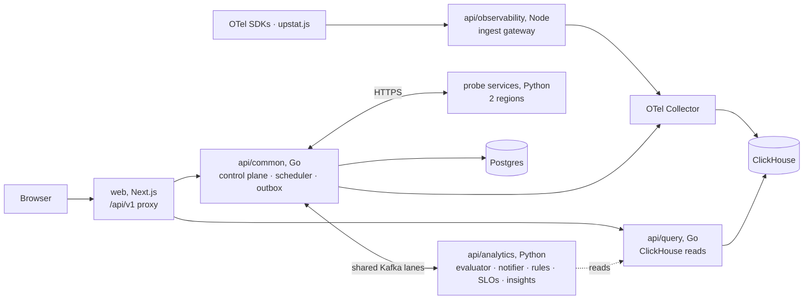

# Upstat

Open-source uptime and status monitoring — schedule health checks against your
services, record incidents, expose status pages, and surface ML-powered
reliability insights.

[](./LICENSE)
[](https://github.com/cuesoftinc/upstat/actions/workflows/build-and-test.yml)

## Overview

Upstat is a monorepo containing the clients, backend services, deployment
configuration, and documentation for the platform. A Go backend owns monitor
state and check execution, a Python service adds analytics and anomaly
detection, and a Next.js frontend serves its dashboard. All traffic between
the browser and the services is HTTP/JSON. For a deeper
description of the components and how they fit together, see
[docs/overview.md](docs/overview.md).

The system design is [docs/system-design.md](docs/system-design.md)
(v3, decided and built 2026-10-29); the decisions behind it are in
[docs/decisions.md](docs/decisions.md).

## Architecture



- **Go does CRUD**: `api/common` owns Postgres and persists every decision;
  `api/query` reads ClickHouse.
- **Python decides**: `api/analytics` turns check results into up/down,
  alerts, rule and SLO states and insights, and sends them back over the
  shared CueLABS message bus.
- **The gateway is thin**: `api/observability` authenticates ingest keys,
  meters bytes and forwards OTLP unparsed; product events are validated
  against the registry and hashed cookielessly.
- **Probes** are Cloud Run services in two regions; a monitor is down only
  when the regions agree.

### Tech stack

| Layer | Technology |
| --- | --- |
| Control plane | Go 1.26, Postgres with row-level security (`api/common`) |
| Telemetry reads | Go 1.26, ClickHouse (`api/query`) |
| Ingest gateway | Node 24, NestJS, OTLP/HTTP + OTLP/gRPC (`api/observability`) |
| Processing | Python 3.12, FastAPI, aiokafka, scikit-learn, Vertex AI (`api/analytics`) |
| Probe | Python 3.12, functions-framework, pycurl (`functions/probe`) |
| Loader | the stock OpenTelemetry Collector |
| Web | Next.js, React, TypeScript; TEST_MODE mock server, HTTP repository client |
| Infrastructure | Docker Compose, Helm, Terraform; Cloud Run in cloud |

## Repository structure

```
api/
  common/          Go: control plane API, scheduler, outbox, consumers, both stores' migrations
  query/           Go: shared query grammar, explorers, RUM, stats, usage
  observability/   Node (NestJS): OTLP and /v1/events ingest gateway
  analytics/       Python: evaluator, notifier, rules, SLOs, ML insights
functions/
  probe/           Python: the HTTP check function (a container for self-host)
web/               Next.js dashboard + status pages
mobile/flutter/    Flutter app (planned)
deploy/
  docker/          compose support files: collector config, store init
  helm/            Helm chart (deploys all services to Kubernetes)
  terraform/       Installs the chart
docker-compose.yml Local and self-host stack
docs/              Project documentation
```

Every service other than `api/common` is named by its function, never by its
language.

## Getting started

### Prerequisites

- [Docker](https://www.docker.com/) & Docker Compose (recommended path)
- For native development: [Go](https://go.dev/) 1.26+, [Node.js](https://nodejs.org/)
  24 (`web/.nvmrc`), Python 3.12+

### Quick start

```bash
cp .env.example .env
make up      # Postgres, ClickHouse, Kafka, Redis, S3, the collector, probe, every service and web (:3000)
make logs    # follow logs
make down    # stop
```

Configuration is provided at runtime via environment variables; compose
has a working default for everything except Google sign-in
(`GOOGLE_CLIENT_ID`, `GOOGLE_CLIENT_SECRET`). See [docs/setup.md](docs/setup.md) for details; `make help` lists all
targets. Never commit credentials or bake them into an image.

## Documentation
- [Hosted docs](https://cuesoft.gitbook.io/upstat) — the full documentation site (auto-synced from `docs/`)

- [Project overview](docs/overview.md) — architecture and components
- [Local setup](docs/setup.md) — development environment and per-service run commands

## Contributing

Contributions are welcome. Please read the [Contributing guide](CONTRIBUTING.md)
and our [Code of Conduct](CODE_OF_CONDUCT.md) before opening a PR.

## Security

Please report vulnerabilities privately — see our [Security policy](SECURITY.md).

## License

See [LICENSE](LICENSE).
