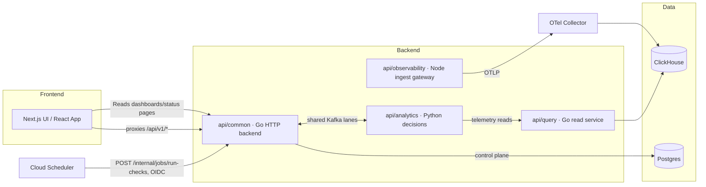
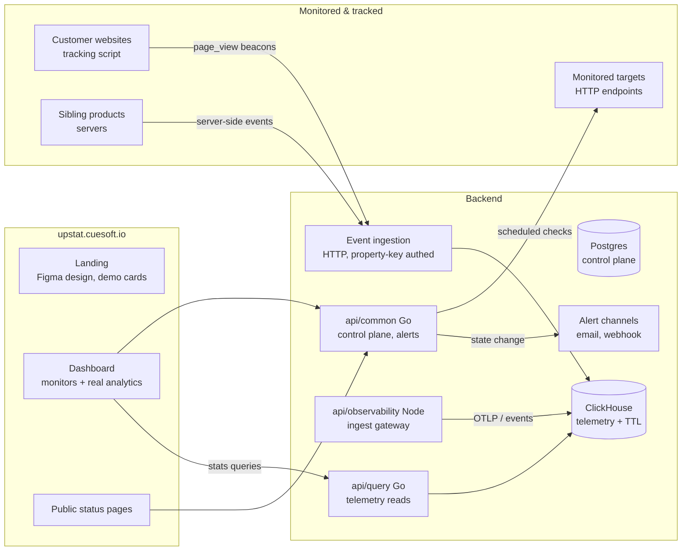
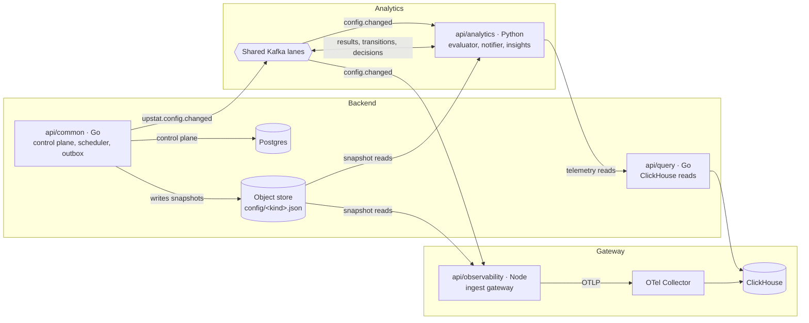
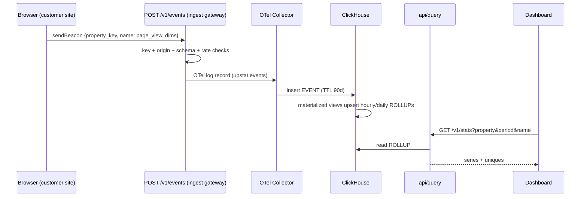
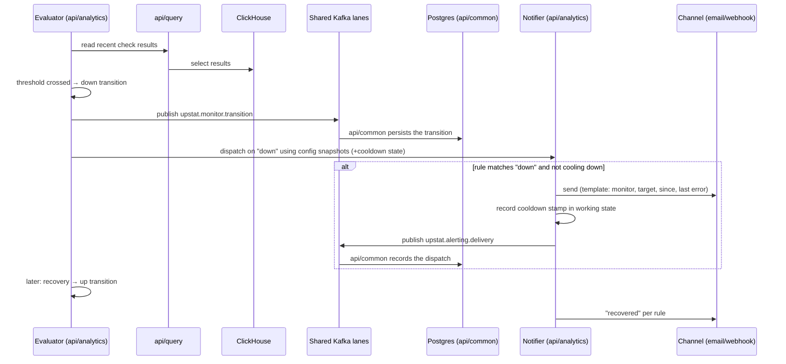
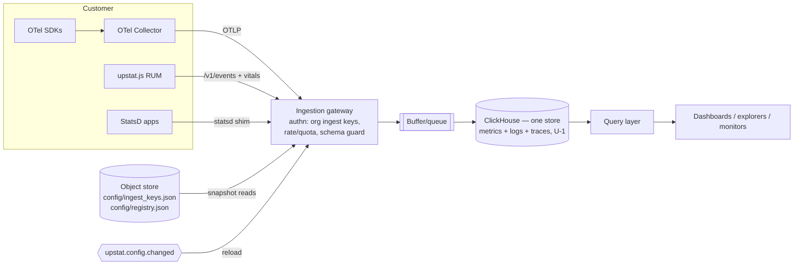

# Upstat — System Architecture

> Canonical structure (ecosystem standard): current state → target state →
> service breakdown → deep dives → deployment → dependencies. Markers:
> **[Current]**, **[PRD]**, **[Specified]**, **[Decided]** — see
> [decisions.md](decisions.md) for ratification detail.

## 1. Context — current state **[Current]**

This diagram describes the main components of Upstat and how they interact.

### 1.1 Components

- **Frontend**: Next.js / React application in `web`.
- **Cloud Scheduler**: job `upstat-run-checks` calls the Go backend every minute on Cloud Run.
- **Go Backend**: HTTP server in `api/common` (port 8080, h2c), serving auth and control-plane routes, the scheduler and outbox.
- **Query Service**: Go read service in `api/query` (port 8083) over ClickHouse.
- **Ingest Gateway**: Node service in `api/observability` (port 8081, OTLP/gRPC 4317) that authenticates ingest keys and forwards telemetry to the OpenTelemetry Collector.
- **Analytics Service**: Python service in `api/analytics` (port 8082) that evaluates checks, dispatches notifications and generates insights; it owns no store.
- **Postgres**: control-plane store for users, orgs, monitors, incidents, rules and dashboards.
- **ClickHouse**: check results and telemetry store, loaded by the collector and read through `api/query`.

### 1.2 Communication patterns

- `UI -> GoBackend`: the web proxies `/api/v1/*` to the common service.
- `Gateway -> Collector -> ClickHouse`: OTel-native OTLP and product events are authenticated at the gateway and loaded into ClickHouse.
- `PythonService -> Query -> ClickHouse`: analytics reads telemetry through the internal query service, not the control-plane store.
- `GoBackend -> Postgres`: control-plane persistence.
- `GoBackend <-> PythonService`: shared Kafka lanes carry config changes, results and transitions; decisions are published back to `api/common`.

### 1.3 Notes

- The system is distributed: services run in separate containers/processes and communicate over network protocols.
- The project currently uses Docker Compose for local orchestration.
- The Go backend runs one pass of due checks per `POST /internal/jobs/run-checks` (Google OIDC guard); the in-process worker loop is for local runs (`WORKER_ENABLED`).
- The shipped web app serves its dashboard data from the in-app mock CRUD
  server (`web/src/app/api/mock/v1`); the proxied HTTP path (shown above) is the
  intended control-plane path, not yet wired (web-implementation.md §1).

## 2. Context — target state **[Decided]**

## 3. Service breakdown — backend + observability internals **[Current]**

## 4. The events layer (M2 + M3) **[Decided]**

This is the design for what sibling roadmaps call **dependency D2** — Upstat
as the ecosystem's standardized event tracker **[PRD §4.2]**.

- **Ingestion**: `POST /v1/events` — plain HTTP/JSON (browser `sendBeacon`
  compatible), authenticated by a *write-only property key* + origin
  allowlist + rate limiting. Payloads validate against a closed schema
  (name + coarse dims only) so sensitive data is rejected structurally
  (data-model.md §2).
- **Tracking script**: `upstat.js` — a few KB, cookieless; auto page-views on
  history changes + `upstat("event", "demo_start")` for custom events.
- **Aggregation**: ClickHouse materialized views maintain hour/day rollups
  with exact-within-bucket uniques (`uniqExact`) via the daily-rotating
  `visitor_hash`, never added across buckets. Dashboards and the stats API
  read rollups through `api/query`, never raw events.
- **Dashboards**: the B6 RUM pillar reads `GET /v1/stats` rollups
  (ANA-002); bounce/SEO/page-load views ship only where honest data
  exists (prd.md §4).

## 5. Alerting (MON-001) **[Decided]**

The `api/analytics` evaluator tracks `consecutiveFailures` vs
`failureThreshold` and emits status transitions — alerting hooks that
transition:

Email provider is an open decision (prd.md §8.2); webhooks are
provider-independent and may ship first if the email decision stalls.

## 6. Observability platform expansion (2026-07-16) **[Specified]**

### 6.1 Ingestion architecture

> **X-5 (shipped):** the control-plane store is **Postgres**; events, check
> results, rollups and OTel telemetry land in **ClickHouse**, with retention
> expressed as table TTLs. The diagrams above show that split. Decision
> provenance stays in [decisions.md](decisions.md).

**OpenTelemetry-native**: OTLP (gRPC 4317 + HTTP 4318) is the single
first-party intake, and per **X-9** the ecosystem's: the sibling products
ship their traces/metrics/logs here (direct SDK export, ingest-key authed),
making the sibling products this gateway's first customers
for traces, metrics, and logs, customers use standard OTel SDKs/collectors,
no proprietary agent to build or maintain. Complements: the existing HTTP
events API + `upstat.js` (RUM), StatsD-compat shim (metrics), uptime checker
(synthetics).

### 6.2 Ingestion operations

- **Buffering**: product events are authenticated at the gateway and forwarded
  to the OTel Collector, which loads ClickHouse; overload answers `429` (never
  silent drop; rejected counters tell the truth). OTLP uses **ClickHouse
  async_insert** as the buffer with gateway backpressure → `429 quota_exceeded`;
  ingest SLO target p99 < 250ms accept latency.
- **ClickHouse ops**: single node to start (sandbox), daily backups to the
  Cloud Storage bucket, disk sized to retention (13mo metrics / 15d logs /
  7d traces), replication deferred until load demands (documented upgrade
  path: ReplicatedMergeTree + 3 keepers).
- **Tenancy isolation**: `org_id` prefixes every ORDER BY (data-model DDL);
  quotas enforced at the gateway per ingest key; per-org query concurrency
  cap 4 in the query layer (noisy-neighbor containment).

### 6.3 The storage decision (U-1, ratified)

The pre-migration store could not serve high-cardinality timeseries or log
search at platform scale. The ratified choice is **ClickHouse as the unified
telemetry store** (metrics, logs, traces in columnar tables — the
Signoz/HyperDX-proven pattern); the control plane is **Postgres** per X-5. The
VictoriaMetrics + OpenSearch split was rejected for operational surface.
Self-host compose ships a ClickHouse container; helm adds a StatefulSet or
external endpoint. **[Ratified; see decisions.md.]**

### 6.4 Query layer

One internal query service translating the shared QueryBar grammar
(design.md §3) to store-specific queries; all pillars and the monitor
evaluator consume it — monitors are "saved queries + thresholds on a
schedule", nothing pillar-specific.

### 6.5 Honesty stance for the build-out

Pillars ship behind org-level feature flags; a pillar is not "available"
until its explorer, retention, and monitor support all work. Marketing may
list pillars as "early access" but the in-app empty states (MI-16) never
pretend data exists. Sequencing in roadmap.md revision.

### 6.6 Non-goals guardrail

Per PRD §5, the target explicitly excludes APM/tracing/log aggregation and
session replay. Any feature request in those directions re-opens the PRD
rather than growing scope silently.

---

## 7. Deployment view

Cloud: [deployment.md](deployment.md) (Cloud Run via your infrastructure-as-code stack, X-3/X-6 —
every service min instances 0, Cloud Scheduler drives checks). Self-host: compose
(Postgres, ClickHouse + services) and the standard-form Helm chart + terraform
in `deploy/` — validated end-to-end on a live cluster.

## 8. Cross-repo dependencies

| ID | Dependency | Direction | Notes |
| --- | --- | --- | --- |
| D2 | Event-ingestion API | **provided by this repo** (Phase 1) | unblocks sibling-product analytics |
| D1 | `account.cuesoft.io` facade | consumed, later | X-1: Google sign-in through the API — not blocking |
| D3 | Upstat clause on privacy.cuesoft.io | consumed | UPS-005 copy |
| X-5/X-7 | managed Postgres + Valkey, Brevo | consumed | shared data/email plane |
