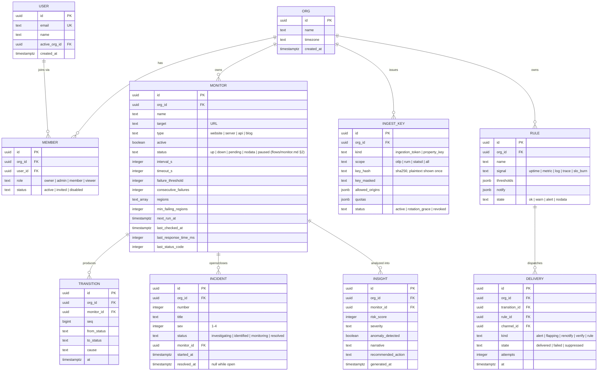
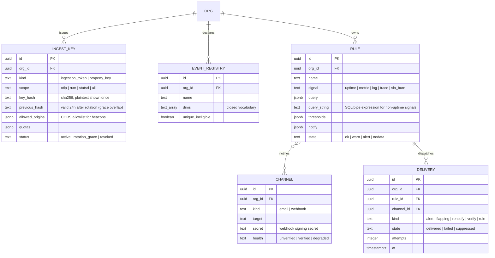
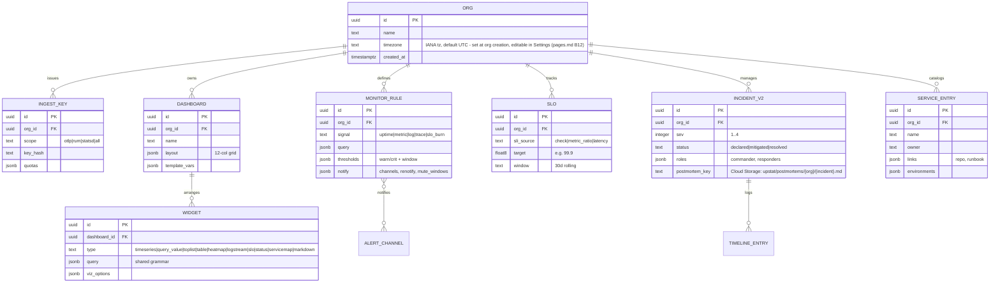

# Upstat — Data Model

> Companion to [prd.md](prd.md) / [architecture.md](architecture.md).
> Markers: **[Current]**, **[PRD]**, **[Proposed]**.

## 1. Current entities **[Current]** — Postgres control plane + ClickHouse telemetry

The control plane lives in Postgres; every tenant table carries `org_id` and
row-level security, and `api/common` is its only client. Check results and
telemetry live in ClickHouse and are read through `api/query`.



ClickHouse holds the high-volume tables; the collector loads them and
`api/query` reads them:

| Table | Key columns | Retention |
| --- | --- | --- |
| `check_results` | `org_id`, `monitor_id`, `tick_id`, `region`, `checked_at`, `ok`, `status_code`, phase timings | 90 days |
| `check_uptime_daily` | `org_id`, `monitor_id`, `day`, uptime aggregate | 13 months |
| `events` | `org_id`, `name`, `ts`, `dims`, `visitor_hash` | 90 days |
| `events_hourly` / `events_daily` | `org_id`, `bucket`, `name`, `events`, exact `uniques` (`uniqExact`) | 90 days / 13 months |
| `otel_logs`, `otel_metrics_*` | standard OTel columns plus `org_id` row policies | 15 days |
| `otel_traces` | standard OTel columns plus `org_id` row policies | 7 days |
| `metrics_1m` / `metrics_1h` | `org_id`, `bucket`, metric aggregates | 90 days / 13 months |

(Field lists are representative; see `api/common/migrations/postgres/*.sql` and
`api/common/migrations/clickhouse/*.sql` for the full DDL.)

## 2. Additions **[Current]** — the analytics/events layer

The ingest and alerting additions live in Postgres; event, rollup and check
result rows live in ClickHouse (§1). `api/common` owns the Postgres rows,
the ingest gateway forwards events to the collector, and `api/analytics`
owns the decisions.



`EVENT`, `ROLLUP` and `VISIT_ROLLUP` are ClickHouse tables, not Postgres rows:
events carry `name`, closed `dims`, `ts` and `visitor_hash`; hourly/daily
rollups carry the `org_id`, `bucket`, `events` and exact-within-bucket
`uniques` (`uniqExact`), never added across buckets. Check results are the
`check_results` table in the same store.

Modeling notes:

- **`EVENT.dims` is a closed, validated vocabulary** — the schema is the
  privacy boundary (prd.md §6): free-form payloads are rejected at ingest so
  sibling products *cannot* leak financial/measurement data into analytics
  even by accident.
- **`visitor_hash`**: cookieless uniques via
  `hash(daily_salt, property, ip, user_agent)`; the salt rotates daily and raw
  IPs are never stored. **[Proposed — the privacy-defining choice, ratify]**
- **Rollups are the query surface**; raw `EVENT` rows exist to rebuild rollups
  and are the first thing retention deletes.
- **Alerting rules are org-scoped** (`rules.org_id`), not stored on a monitor;
  non-uptime rules are evaluated org-wide (uptime rules still react to a
  monitor's transitions). Channels are reusable and org-scoped; email requires
  a provider decision (prd.md §8.2 — old SMTP plumbing was deliberately
  removed and should return via one well-chosen provider).

## 3. Storage mapping

| Concern | Choice | Rationale |
| --- | --- | --- |
| Control plane | **Postgres** (`upstat` db, row-level security) **[Current]** | users, orgs, monitors, transitions, incidents, rules, channels, deliveries, insights; `api/common` is the only client |
| Events + rollups | **ClickHouse** tables loaded by the OTel Collector **[Current]** | events and rollups are high-volume and TTL-managed; read through `api/query` |
| Check results | **ClickHouse** `check_results` **[Current]** | probe results land here via the collector; Postgres keeps only the latest status fields on `monitors` |
| Alert dispatch state | Postgres `deliveries` (rule cooldown timestamps) | avoids a queue dependency at this scale |

## 4. Retention & privacy **[Proposed defaults, to ratify + publish per UPS-003/005]**

| Data | Retention | Notes |
| --- | --- | --- |
| Raw events | 90 days (TTL) | rollups carry the history |
| Rollups (hour) | 90 days | day rollups cover longer horizons |
| Rollups (day) | 13 months | year-over-year comparisons |
| Check results | 90 days | insights summarize older history |
| Incidents | indefinite | they are the historical record |
| Visitor identifiers | never stored raw | `visitor_hash` only, daily-rotating |

| Class | Data | Rules |
| --- | --- | --- |
| Visitor data | events, visitor_hash | cookieless, anonymized, no cross-property joins; disclosed on the privacy page (UPS-005) |
| Customer data | monitors, targets, alert configs | targets may embed internal hostnames — treat as confidential |
| Operational | checks, rollups, insights | safe for internal metrics |

---

## 5. Observability platform entities (2026-07-16) **[Proposed]**

Control plane additions (**managed Postgres** per X-5; entity names keep their shapes):



Identity posture (X-10, ratified 2026-07-16, [decisions.md](decisions.md)):
upstat is **tier 0 + tier-1-minimal**, Google identity (X-1) plus exactly
one profile field, `ORG.timezone` (IANA, default `UTC`; set at org creation,
editable in Settings, pages.md B12). It exists so report rendering and
time-bucketing *display* resolve in the org's timezone while storage and
rollups stay UTC ([analytics-math.md](analytics-math.md) §3). The `country`
in `EVENT.dims` (§2) is a coarse *event* dimension, **not** org identity —
no address or country identity field exists. Tier 2 (provider-verified
financial identity) is N/A until billing enters the PRD.

### Telemetry-plane DDL sketch (ClickHouse, U-1 — draft to finalize at OBS-001)

```sql
CREATE TABLE metrics_points (
  org_id LowCardinality(String), series_hash UInt64,
  name LowCardinality(String), tags Map(String, String),
  ts DateTime64(3), value Float64
) ENGINE = MergeTree
  PARTITION BY toYYYYMM(ts)
  ORDER BY (org_id, series_hash, ts)
  TTL toDateTime(ts) + INTERVAL 13 MONTH;

CREATE TABLE logs (
  org_id LowCardinality(String), service LowCardinality(String),
  level LowCardinality(String), ts DateTime64(3),
  message String, attrs Map(String, String), trace_id String
) ENGINE = MergeTree
  PARTITION BY toDate(ts)
  ORDER BY (org_id, service, ts)
  TTL toDateTime(ts) + INTERVAL 15 DAY;

CREATE TABLE spans (
  org_id LowCardinality(String), trace_id String, span_id String,
  parent_id String, service LowCardinality(String), name LowCardinality(String),
  start DateTime64(6), duration_ns UInt64, status UInt8,
  attrs Map(String, String)
) ENGINE = MergeTree
  PARTITION BY toDate(start)
  ORDER BY (org_id, service, start)
  TTL toDateTime(start) + INTERVAL 7 DAY;
```

`org_id` leads every ORDER BY — the tenancy-isolation primitive (queries are
always org-scoped; cross-org reads are structurally awkward by design).

Retention defaults extend §4's table: metrics 13mo (rollup-thinned), logs
15d hot (+archive later), traces 7d sampled **[Proposed]**; schemas are
finalized during OBS-001 design.
