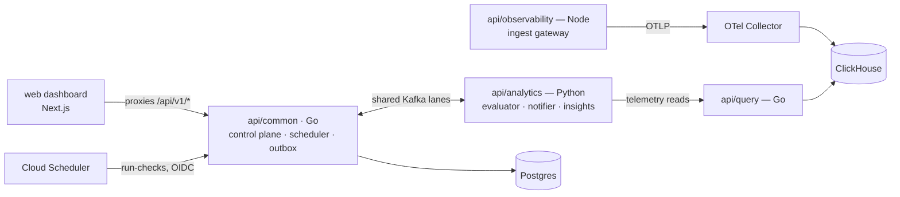

# Overview

Upstat is an open-source uptime and status monitoring platform. It schedules
health checks against services, records incidents, serves status pages, and
generates ML-powered reliability insights.

## Architecture

- **`web`** — Next.js dashboard and public status pages. Currently serves
  dashboard data from its in-app mock CRUD server (`/api/mock/v1`); talking
  to the backend through the web's `/api/v1/*` proxy is the target control
  plane (not yet wired).
- **Cloud Scheduler**: job `upstat-run-checks` calls `POST /internal/jobs/run-checks` on api/common every minute.
- **`api/common`** — Go HTTP backend (port 8080, h2c): auth, control-plane
  routes, the scheduler and outbox, backed by Postgres.
- **`api/observability`** — Node ingest gateway: authenticates ingest keys,
  meters bytes and forwards OTLP and product events to the OpenTelemetry
  Collector, which loads ClickHouse.
- **`api/query`** — Go read service over ClickHouse for the dashboard and
  analytics.
- **`api/analytics`** — Python service: the evaluator, notifier and insight
  pipeline. It reads telemetry through `api/query` and shares Kafka lanes
  with `api/common`.
- **Data** — Postgres holds control-plane data (users, orgs, monitors,
  incidents, rules and dashboards); ClickHouse holds check results and
  telemetry, served by `api/query`.
- **Auth**: Google single sign-on run by the Go backend (PKCE, one-time
  handoff code, session JWT and cookie); internal service calls use
  `INTERNAL_TOKEN` locally or Google ID tokens on Cloud Run.

The key architectural boundary: `api/common` owns the Postgres control plane
and the scheduler; the ingest gateway and collector land telemetry in
ClickHouse; `api/analytics` owns the decisions (evaluation, notification and
insights), reading telemetry through `api/query` and exchanging config and
results with `api/common` over shared Kafka lanes.

See [setup.md](setup.md) to run the stack locally, [architecture.md](architecture.md)
for detailed data flows, and the
[repository structure](https://github.com/cuesoftinc/upstat#repository-structure) in the README.

## Product & design documentation
> Published site: **https://cuesoft.gitbook.io/upstat** (Git-synced from this folder on every merge to main).

- [prd.md](prd.md) — product requirements breakdown (triple mandate: monitoring, analytics, ecosystem tracking)
- [architecture.md](architecture.md) — current system + PRD-phase target design (events layer, alerting)
- [data-model.md](data-model.md) — current + target entities, retention & privacy defaults
- [api.md](api.md) — HTTP surface map + the /v1/events ecosystem contract ("D2")
- [roadmap.md](roadmap.md), phased plan; Phase 1 unblocks sibling-product analytics
- [design.md](design.md) + [pages.md](pages.md) — design language, pillars, microinteractions
- [query-grammar.md](query-grammar.md) — the shared query grammar behind explorers, widgets, monitors
- [decisions.md](decisions.md) — the open-decision register: ratify to unblock phases
- [deployment.md](deployment.md), Cloud Run + App Hosting contract (infrastructure-as-code provisioning, CI/CD pattern)
- flows/ — feature flow specs with edge cases: [auth](flows/auth.md), [monitor](flows/monitor.md), [alert](flows/alert.md)
- [analytics-math.md](analytics-math.md) — visitor hashing, sessionization, rollups, uniques honesty rules
- [engineering.md](engineering.md) — error catalog, authz matrix, rate limits, testing strategy, logging rules
- [features.md](features.md) — granular build backlog (stable unit IDs per phase)
