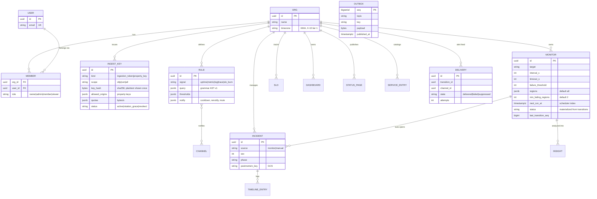
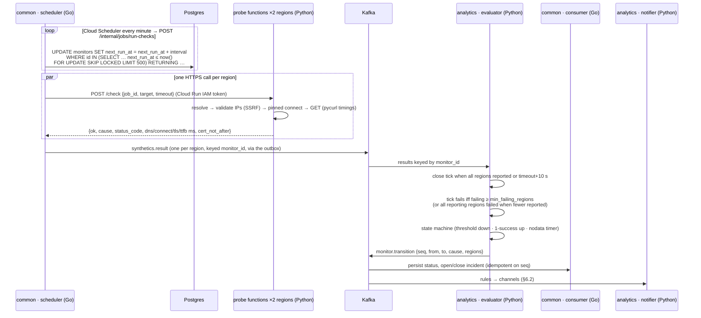
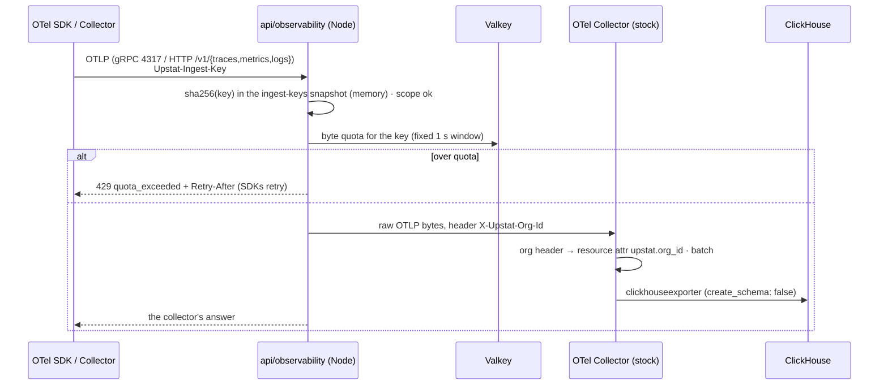

# Upstat — System Design

> **Status: [Decided] v3 — decided and built 2026-10-29, pending the
> boss's review** (S-1…S-13 in [decisions.md](decisions.md#system-design-s-1--s-13)).
> v3 folds in the 2026-10-13 shared-bus amendment (X-11): telemetry never
> rides the bus, config travels as snapshot objects, and the lanes carry
> only control events. §16 records what building it settled. This document
> replaces the system design described across `architecture.md` §1–§7,
> `data-model.md` §3 and `deployment.md` §1. It keeps every **product**
> decision in [decisions.md](decisions.md) (Google-only auth, ClickHouse,
> managed Postgres/Valkey, Brevo, Vertex AI, Cloud Run, merge-to-main
> deploys, OTel everywhere) and every **behavioural** contract in the flow
> docs (monitor state machine, alert dispatch, analytics math, query
> grammar).
>
> **Language rule (CueLABS standard):**
>
> - **Go does CRUD only.** `api/common` owns and persists data, and
>   `api/query` reads the telemetry plane.
> - **Python does all processing:** every decision (up/down, alert routing,
>   rule and SLO state, anomalies) lives in `api/analytics`.
> - **The gateway is thin.** `api/observability` (NestJS) validates and
>   hands off.
> - **Probes are serverless functions**, the only use the standard allows
>   for functions.
>
> **On the shared message bus (X-11):** Upstat's events ride the three
> CueLABS lanes under the delivery standard's shared messaging contract
> (envelope, pointers-only payloads, two partitions, no compaction, fixed
> retention). One Kafka user, `upstat`; consumer groups `upstat-common`,
> `upstat-analytics`, `upstat-query`, `upstat-observability`. The sibling
> expenses product owns the keep-alive; Upstat runs no heartbeat. Only the
> deployed services (the `stg` secrets config) connect to the shared
> service; local runs use the compose broker.

## Contents

1. Why redesign — audit findings
2. Design drivers
3. Architecture overview
4. Services
5. Data architecture
6. Key flows
7. API surface
8. Security and tenancy
9. Reliability, failure modes, and capacity
10. Deployment topology
11. Repository layout
12. Reuse map — keep, change, retire
13. Decisions to ratify
14. Migration plan
15. Open questions

---

## 1. Why redesign — audit findings **[Current]**

The code on `main` is small: roughly 2.3k lines of Go (`api/common`), 1.6k
lines of Python (`api/observability`), and 38k lines of TypeScript in `web`,
which today runs entirely on its in-app mock server. The product target
(prd.md §9) is a full observability platform. The current shape cannot
grow into that target without being rebuilt, for these reasons:

| #   | Finding                                                                                                                                                     | Evidence                                                                                                        | Consequence                                                                                                                                                    |
| --- | ----------------------------------------------------------------------------------------------------------------------------------------------------------- | --------------------------------------------------------------------------------------------------------------- | -------------------------------------------------------------------------------------------------------------------------------------------------------------- |
| F1  | **One Go process does four jobs**, three of which are decisions. `api/common` is the API, the check scheduler, the prober, and the state-machine evaluator. | `cmd/server/main.go` starts `MonitorWorker` in-process; `monitor_worker_service.go` polls, probes, and decides. | This breaks the standard, which says Go only does CRUD. The API also can't scale without duplicating checks.                                                   |
| F2  | **Checks run in lock-step batches.** Each 5 s tick lists _every_ active monitor, then `wg.Wait()`s for the whole batch at concurrency 10.                   | `runOnce()`; `ExecuteHttpCheck` retries 3× with 500 ms sleeps and a 10 s default timeout.                       | Ten slow targets (≈31 s each) stall every other monitor for ~31 s. Check timing drifts under load.                                                             |
| F3  | **Single-vantage probing.** All checks come from one region, the same one that hosts the API.                                                               | One worker, one Cloud Run region today; the target probes from two.                                             | Our own network blips page customers as "down", and a regional outage silences all alerting. The in-check 3× retry hides flapping and inflates response times. |
| F4  | **The SSRF hard rule isn't implemented.**                                                                                                                   | No private/link-local/metadata IP validation anywhere in `api/` (flows/monitor.md §1 requires it).              | On Cloud Run, a monitor targeting `169.254.169.254` reaches the metadata server.                                                                               |
| F5  | **Cyclic, synchronous service coupling.** `common` and `observability` call each other over HTTP, and Python opens its own Mongo connection.                | `api/observability/repository/monitor_repository.py`; `api/observability/database/mongo.py`.                    | Breaks the standard's pipeline rule (the processor never touches common's store), and is exposed to the Cloud Run zombie-channel problem.                      |
| F6  | **Telemetry in the control-plane store.** Check results sit in Mongo, and Phase 1 plans to put events in Postgres and later move them to ClickHouse.        | data-model.md §3, features.md U1-0.                                                                             | Everything gets built twice, and the control-plane database carries the highest-write workload.                                                                |
| F7  | **Ingestion is planned as a custom gateway that also writes storage.**                                                                                      | api.md §1a.                                                                                                     | Mixes a thin gateway with persistence, and reinvents loaders that already exist (the OTel Collector, ClickHouse's Kafka engine).                               |
| F8  | **An unused browser protocol layer (resolved 2026-10-28).**                                                                                                 | The web read `/api/mock/v1` and never called the generated client.                                              | The client and its proxy are removed; the web has one HTTP repository client.                                                                                  |
| F9  | **The docs contradict themselves.** architecture.md §6.6 excludes APM/tracing/logs, while prd.md §9 makes them core.                                        | —                                                                                                               | Contributors can't tell which design is current.                                                                                                               |

What _is_ solid and carries forward: the behavioural contracts (flows/*,
analytics-math, query grammar, engineering error catalog and authz
matrix), the web app and its mock API (already a complete HTTP contract,
§7.3), the check/incident semantics in the worker (they move to Python),
the Python analysis and ML modules, and the delivery scaffolding.

---

## 2. Design drivers

| #   | Driver                                                                     | Design response                                                                                                                                                                                                             |
| --- | -------------------------------------------------------------------------- | --------------------------------------------------------------------------------------------------------------------------------------------------------------------------------------------------------------------------- |
| D1  | **The monitor must not share fate with what it monitors, or with itself.** | Probes are serverless functions in two regions. Alert decisions never depend on the UI. Status pages are CDN-cached. An external dead-man's switch watches Upstat (§9.3).                                                   |
| D2  | **Language by role** (the standard's pipeline rule).                       | Go = CRUD (`common` writes, `query` reads). Python = processing (`alerting`, `observability`). Node = thin gateway (`ingest`). Functions = probes.                                                                          |
| D3  | **Two planes, one owner each.** | **Control plane:** Postgres, written only by `api/common`. **Telemetry plane:** ClickHouse, written only by the stock collector, read only by `api/query`. Go owns both schemas (migrations live in `api/common`). |
| D4  | **Asynchronous by default between services.** | The shared bus carries every decision hand-off. Synchronous internal calls: `common → probe` (a check needs its answer), `common → query` and `analytics → query` (reads). Service traffic is HTTP. |
| D5  | **No custom code where a stock component exists.** | Loading ClickHouse is the stock OpenTelemetry Collector; rollups are ClickHouse materialized views. |
| D6  | **Config flows outward as snapshots.** | `api/common` rewrites a snapshot object per config kind through its transactional outbox and announces it with `upstat.config.changed` (no compacted topics, X-11). The gateway, query and analytics keep an in-memory copy and never query Postgres. |
| D7  | **Privacy by construction.**                                               | Raw IPs never leave the gateway's memory. The event schema is the privacy boundary. Row-level tenancy is enforced in both stores.                                                                                           |
| D8  | **One set of images for cloud and self-host.**                             | Every managed dependency has a single-container self-host equivalent. The probe function also runs as a container for self-host.                                                                                            |

---

## 3. Architecture overview

```mermaid
flowchart LR
    subgraph Clients
        BR[Browser]
        JS[upstat.js<br/>customer sites]
        OT[OTel SDKs / Collectors]
    end

    subgraph Edge
        WEB[web — Next.js<br/>App Hosting + CDN]
    end

    subgraph Go, CRUD
        COMMON[api/common, Go<br/>auth · orgs · CRUD · scheduler · outbox]
        QRY[api/query, Go<br/>reads ClickHouse]
    end

    GW[api/observability — Node<br/>thin gateway]
    PRB[probe · Cloud Run functions<br/>Python · 2 regions, planned]

    subgraph Python, processing
        ALR[api/analytics, Python<br/>quorum · state machine · notify<br/>rules · SLOs · insights]
    end

    LD[Loader — stock, no custom code<br/>OTel Collector]
    PG[(Postgres)]
    CH[(ClickHouse)]
    R[(Valkey)]
    K[[managed Kafka]]

    BR --> WEB
    WEB -->|proxies /api/v1/*| COMMON
    WEB -->|proxies /api/v1/query, stats …| QRY
    JS -->|/v1/events| GW
    OT -->|OTLP| GW

    COMMON --> PG
    COMMON <-->|HTTPS call → result| PRB
    COMMON -->|config changed · check results| K
    K -->|decisions| COMMON
    GW -->|OTLP · events · usage| LD
    COMMON -->|check results as OTLP logs| LD
    K -->|results · config| ALR -->|transitions · deliveries · insights| K
    LD --> CH
    QRY --> CH
    ALR -. read .-> QRY
    COMMON -. read .-> QRY
    COMMON -.- R
    GW -.- R
    ALR -.- R
```

---

## 4. Services

Five deployables we write (web, two Go, one Node, one Python), plus one
serverless function and the stock collector. Ports follow the standard:
`api/common` 8080, then each service in the order it was added:
`observability` 8081, `analytics` 8082, `query` 8083.

| Unit                | Lang              | Role                | Responsibility                                                                                                                                                                                                                                                                                                                                                                                                                           | Owns                                            | Port                           |
| ------------------- | ----------------- | ------------------- | ---------------------------------------------------------------------------------------------------------------------------------------------------------------------------------------------------------------------------------------------------------------------------------------------------------------------------------------------------------------------------------------------------------------------------------------- | ----------------------------------------------- | ------------------------------ |
| `web`               | Next.js           | Frontend            | Landing, dashboard, public status pages (ISR), `/docs/api`, serves `upstat.js`                                                                                                                                                                                                                                                                                                                                                           | —                                               | 3000                           |
| `api/common`        | **Go**            | **CRUD (write)**    | Control-plane API: Google SSO sessions, orgs/roles, monitors, rules, channels, incidents, SLOs, dashboards, keys, event registry, catalog, status pages. **Check scheduler** (lookup-then-write) that calls the probe functions and relays their results to Kafka. **Outbox publisher.** Persists every decision Python makes (transitions, incidents, deliveries, insights). Owns the Postgres **and** ClickHouse schemas (migrations). | **Postgres** (sole client)                      | 8080                           |
| `api/observability` | **Node** (NestJS) | Thin gateway | OTLP over HTTP and gRPC, and `/v1/events`: key auth from the ingest-keys snapshot, scope, byte quotas, origin allowlist, event-registry validation, `visitor_hash`, then forward to the collector. **OTLP payloads pass through unparsed.** Reports usage bytes. | nothing | 8081 (+4317 gRPC) |
| `api/query` | **Go** | **CRUD (read)** | Parses the shared grammar, compiles an org-scoped query to parameterized SQL, routes by time range (raw/1m/1h), enforces limits, caches settled results in memory. Serves explorers, dashboards, RUM, `/v1/stats`, usage, and the internal reads common and analytics make. | read-only ClickHouse user | 8083 |
| `api/analytics` | **Python** | Processing | **Evaluator:** multi-region quorum, the monitor state machine (flows/monitor.md §2), nodata timers. **Notifier:** rules → channels, cooldown, flapping, renotify, retries, webhook signing, Brevo. **Rules and SLOs** through `api/query`. **Insights:** anomaly model, risk, Vertex AI narrative (Groq/Gemini BYO key for self-host), in the background. | working state in Valkey (rebuildable) | 8082 |
| `probe` | **Python** | Serverless function | One HTTP check (or one multi-step run) per call: SSRF-safe pinned connect, DNS/connect/TLS/TTFB timings (pycurl), certificate expiry. **Cloud Run functions in 2 regions** (us-central1, us-east4); a container for self-host. | nothing; no secrets, no IAM roles | n/a (8090 in compose) |
| Loader | stock | Infrastructure | **OpenTelemetry Collector** (contrib image, configuration only): OTLP → ClickHouse, org from the gateway's header. | — | — |

**Retired:** the in-process
`MonitorWorker`, the Phase-1 rollup worker
(replaced by ClickHouse MVs), and the Go-based checker (it moves to the
Python probe function).

**Why these boundaries.**

- **`query` is separate from `common`** because one expensive log search
  must never queue behind, or starve, the control-plane API.
- **Alerting and insights share `analytics`** (one Python service to run
  and deploy), but insights run as background tasks after a transition's
  notifications are delivered, and their failures are caught: an ML crash
  or a slow Vertex AI call never delays a "site is down" alert.
- **Probes are functions**, which is the one use the standard allows.
  They're regional by deployment, hold zero privileges, and scale to
  zero between checks.

---

## 5. Data architecture

### 5.1 Stores and ownership

| Store                                                                                 | Holds                                                                                                                                                                                                               | Written by                                                   | Read by                      | Source of truth?                                                   |
| ------------------------------------------------------------------------------------- | ------------------------------------------------------------------------------------------------------------------------------------------------------------------------------------------------------------------- | ------------------------------------------------------------ | ---------------------------- | ------------------------------------------------------------------ |
| **Managed Postgres** (database and user `upstat`)                                     | Control plane (§5.2) + outbox                                                                                                                                                                                       | `api/common`                                                 | `api/common`                 | Yes                                                                |
| **ClickHouse** (hosting is the boss's call, S-4) | Spans, logs, metrics, check results, events, rollups, usage (§5.3) | **only by the OTel Collector** (insert-only `loader` user) | `api/query` (read-only `query_ro` user) | Yes, for telemetry |
| **Shared Kafka** (X-11) | Control events only (§5.4) | per event | per event | No: a pointer channel; every decision is persisted by common |
| **Managed Valkey** (user `upstat`, keys `upstat:*`)                                   | `common`: per-user API rate limits (engineering.md §3). `observability`: per-key byte quotas, pre-auth IP limits, daily visitor-hash salts. `analytics`: evaluator working state, cooldown stamps, 30-min flapping windows. | those three                                                  | same                         | No. Losing it is survivable (§9.2).                                |
| **Cloud Storage** `upstat/<env>/…` | `config/` snapshots, `compute/` claim-check payloads (deleted after a day), `postmortems/` | common; analytics (compute/) | observability, query, analytics | Yes, for blobs |

`api/query` deliberately does **not** use Valkey. It caches results in
process memory and enforces the per-org concurrency cap per instance.
That drops a dependency from the read path at the cost of cache hits
across instances, which is fine at this scale.

### 5.2 Control plane — Postgres

Every tenant-owned table carries `org_id`. Row-level security is on, with
the policy `org_id = current_setting('upstat.org_id')`. `api/common` sets
this per transaction, and the repository layer filters on `org_id` too.



Tables in data-model.md §2/§5 keep their fields. The table above shows
only what the redesign adds or changes: Google sign-in
replaces `password_hash` (accounts key on the Google-verified email); monitors gain `regions`, `min_failing_regions`,
`next_run_at`, and `last_transition_seq`; `PROPERTY` folds into
`INGEST_KEY` (`kind = property_key`), matching the web's `ApiKey` model;
`DISPATCH` becomes `DELIVERY`; and one `INCIDENT` table covers both
auto-opened monitor incidents and declared SRE incidents. **No telemetry
in Postgres.**

### 5.3 Telemetry plane — ClickHouse

Schemas are Go-owned migrations in `api/common/migrations/clickhouse`.

- **OTel tables** use the `clickhouseexporter` canonical schema (the one
  ClickStack/HyperDX query), created with `create_schema: false`. The
  migration adds
  `org_id LowCardinality(String) MATERIALIZED ResourceAttributes['upstat.org_id']`
  and leads every `ORDER BY` with `org_id`. The loader copies the Kafka
  header `org_id` (set by the gateway) into that resource attribute
  (§6.3).
- **Upstat-native tables:**

| Table                                  | Engine / key                                                                                                                                                     | TTL (U-6)    | Fed by                              |
| -------------------------------------- | ---------------------------------------------------------------------------------------------------------------------------------------------------------------- | ------------ | ----------------------------------- |
| `otel_traces`                          | MergeTree, `(org_id, ServiceName, SpanName, toDateTime(Timestamp))`                                                                                              | 7 d          | OTel Collector loader               |
| `otel_logs`                            | MergeTree, `(org_id, ServiceName, TimestampTime)` + token bloom index on `Body`                                                                                  | 15 d         | OTel Collector loader               |
| `otel_metrics_{gauge,sum,histogram,…}` | exporter schema + `org_id`                                                                                                                                       | raw 15 d     | OTel Collector loader               |
| `metrics_1m`, `metrics_1h`             | AggregatingMergeTree MVs                                                                                                                                         | 90 d / 13 mo | MV on raw metrics                   |
| `check_results` | MergeTree, `(org_id, monitor_id, scheduled_at, region)`; `ok`, `cause`, `status_code`, phase timings, `total_ms`, `cert_not_after` | 90 d | MV ← `otel_logs` (service `upstat.checks`) |
| `check_uptime_daily`                   | AggregatingMergeTree MV                                                                                                                                          | 13 mo        | MV (status-page bars, 90 d strips)  |
| `events` | MergeTree, `(org_id, property_id, name, ts)`; typed dim columns (closed vocabulary), `value`, registered `dims` | 90 d | MV ← `otel_logs` (service `upstat.events`) |
| `events_hourly`, `events_daily`        | AggregatingMergeTree, `uniqState(visitor_hash)`                                                                                                                  | 90 d / 13 mo | MV                                  |
| visits | sessionized at query time with window functions, 30-min gap (analytics-math §2) | — | `api/query` |
| `usage_hourly` | SummingMergeTree | 13 mo | MV ← `otel_logs` (service `upstat.usage`) |

Late events land in the right bucket automatically, because aggregating
MVs merge late inserts. That settles analytics-math §7's rollup-worker
concerns by construction.

**Row policy (defense in depth):** the `query_ro` user has
`CREATE ROW POLICY … USING org_id = getSetting('SQL_upstat_org')`, and
`api/query` sets that setting on every query in addition to injecting the
predicate.

### 5.4 Kafka events (on the shared bus)

Upstat uses the shared message bus (decisions.md X-11; the shared
messaging contract is the source of lanes, envelope, limits and
operations). Only control-plane hand-offs ride it; telemetry goes through
the OpenTelemetry Collector. JSON Schemas live in `api/common/contract/`
with an example per event, and every payload travels by pointer.

| Event | Lane | Key | Producer → consumers |
| --- | --- | --- | --- |
| `upstat.config.changed` | `cuelabs.requests` | config kind | common (outbox) → observability, query, analytics (reload the snapshot) |
| `upstat.synthetics.result` | `cuelabs.requests` | monitor id | common (relaying probe responses) → analytics |
| `upstat.alerting.verify_requested` | `cuelabs.requests` | channel id | common → analytics (sends the test) |
| `upstat.monitor.transition` | `cuelabs.results` | monitor id | analytics → common, analytics (notifier, insights) |
| `upstat.alerting.delivery` | `cuelabs.results` | monitor or channel id | analytics → common |
| `upstat.rule.evaluated` | `cuelabs.results` | rule id | analytics → common |
| `upstat.slo.evaluated` | `cuelabs.results` | SLO id | analytics → common |
| `upstat.insights.generated` | `cuelabs.results` | monitor id | analytics → common |

At the expected scale (one result per region per monitor per minute, a
handful of decisions) this stays far inside the shared service's
250 KiB/s: each message is a few hundred bytes of pointer.

---

## 6. Key flows

### 6.1 Uptime check, end to end



- **Go stays CRUD.** The scheduler is a lookup-then-write (select due
  monitors, advance `next_run_at`) plus a relay (call the function,
  publish what it returned). Deciding up/down, the quorum and the state
  machine all live in Python, in `api/analytics`.
- **No singleton, no loop.** `FOR UPDATE SKIP LOCKED` lets any number of
  `common` instances schedule without double-dispatch. `common` scales to
  zero, so no background loop runs between requests: Cloud Scheduler job
  `upstat-run-checks` calls `POST /internal/jobs/run-checks` every minute
  (Google OIDC token, verified against `SCHEDULER_AUDIENCE` and
  `SCHEDULER_INVOKER_EMAIL`), and each call runs one pass of due checks.
  The shortest check interval is therefore 60 s.
- **Why common calls the functions directly, not through Kafka.** Cloud
  Run functions are triggered by HTTP, not by Kafka. The call also returns
  the result in its response, so the function needs **no Kafka
  credentials and no secrets at all**. That matters for code that fetches
  arbitrary customer URLs (§8).
- **Jitter.** `next_run_at` is seeded as `created_at + hash(id) mod
interval`, which keeps flows/monitor.md §3's anti-thundering-herd rule.
- **Timeouts.** `common` waits at most `timeout + 5 s` per call. A missing
  region is treated as "no result", never as a failure. Stale slots are
  skipped (next slot wins).
- **No in-check retries.** Multi-region quorum plus the failure threshold
  does the damping, and response times are single-attempt measurements.
- **`nodata` and tick deadlines.** The evaluator keeps each monitor's
  state and its open ticks in Valkey, so any instance can close them, and
  takes the monitor config from the monitors snapshot (no co-partitioning
  on a two-partition lane). Every run-checks pass ends with
  `POST /internal/settle` on analytics (S-14), which evaluates: it closes ticks
  past `timeout + 10 s` and runs the 2×interval timer. If every region
  fails to report, the monitor goes `nodata`, never `down`.
- **Extras from the same check.** Phase timings feed the check-detail waterfall, and
  `cert_not_after` gives OBS-011 certificate-expiry warnings without a new
  check type.

### 6.2 Alert dispatch (MON-001, flows/alert.md unchanged in behaviour)

- The notifier (Python, in `api/analytics`) consumes `monitor.transition`,
  **keyed by `monitor_id`**. A monitor's `down` and `recovered` are
  therefore handled in order by one consumer, which satisfies
  flows/alert.md §3's ordering rule without coordination.
- For each matching rule and channel, it delivers with a 10 s timeout and a
  1 s / 5 s / 25 s retry ladder. The Kafka offset is committed only after
  every delivery for that transition is terminal: at-least-once delivery
  that survives a crash.
- Duplicates after a crash carry the same `X-Upstat-Delivery-Id`, and the
  documented webhook recipe tells consumers to dedupe on it.
- Cooldown stamps and the flapping window live in Valkey. If Valkey is lost,
  the notifier fails open: it sends, and never silently suppresses.
- Outcomes go to `upstat.alerting.delivery`, which `common` persists as the
  alert feed (MI-14) and uses to drive channel `degraded` badges.

### 6.3 OTLP ingestion (OBS-001; the ecosystem gateway role)



- **The gateway never parses OTLP.** It authenticates, meters the bytes and
  forwards the payload unchanged; gRPC messages stay raw bytes through a
  pass-through serializer and are forwarded as OTLP/HTTP protobuf.
- **The org comes from the key, never the payload:** the collector's
  `resource/org` processor upserts `upstat.org_id` from the gateway's
  header, overwriting anything a customer sent.
- **Quotas are bytes per second** per key (S-11), shared across instances
  in Valkey; each instance falls back to its own counters if Valkey is away.
- **The loader is configuration, not code**
  (`deploy/docker/otel-collector.yaml`). Its persistent sending queue is
  the ClickHouse-outage budget (§9.2).
- **Cloud Run shape.** One port per service, so the gateway deploys twice
  from one image: `upstat-api-observability` (OTLP/HTTP and events) and
  `upstat-api-observability-grpc` (end-to-end HTTP/2, `GRPC_PORT`).
  Self-host runs one container with both ports. The collector is private
  to the gateway and common.
- **StatsD** needs UDP, which Cloud Run can't serve. Customers run the
  stock collector's `statsd` receiver locally and export OTLP to us.

### 6.4 Product events and RUM (D2, ANA-001, OBS-007)

`api/observability` serves `POST /v1/events` with the contract in api.md §3
unchanged: batch ≤ 100, per-item rejections, `202 {accepted, rejected,
rejections}`. For each request it:

1. authenticates the property key and matches `Origin` against its
   allowlist;
2. validates each event against `config.registry` (registry-as-schema,
   api.md §3.4a);
3. computes `visitor_hash` (analytics-math §1) with the daily salt from
   Valkey (`SETNX salt:<utc-day>`, 72 h TTL, so it self-destructs after the
   48 h window). The IP and user agent are dropped here and **never reach
   Kafka**;
4. forwards the accepted events to the collector as OTLP logs (service
   `upstat.events`); the `events_mv` view types them into `events`, whose
   MVs keep hourly and daily rollups. Visits are sessionized by
   `api/query`. Built-in browser events (`page_view`, `web_vital`,
   `js_error`) need no registration.

Checking a key, a schema, and a hash is validation, not a decision, so it
belongs in the gateway by the standard's definition.

### 6.5 Query path

- `web` proxies `/api/v1/*` server-side. It routes
  `/v1/query`, `/v1/stats`, `/v1/logs*`, `/v1/traces*`, `/v1/metrics*`, and
  `/v1/rum*` to `api/query` (Go), and everything else to `api/common`, each
  at its own run.app URL.
- `api/query` verifies the session token with the shared Go auth package
  and resolves membership and role from `config.members`, held in memory.
- It parses the grammar into the **same `QueryAst v1` the web already
  defines** (`web/src/models/query.ts`) and compiles it with a structured
  SQL builder: org predicate always injected, time range always
  parameterized.
- **Tier routing:** up to 6 h reads raw data; up to 7 d reads `*_1m`;
  anything longer reads `*_1h`.
- **Guards:** `max_execution_time`, `max_memory_usage`, and
  `max_result_rows` per query; a per-org cap of 4 concurrent queries per
  instance; `429` when exceeded.
- **Cache:** in-process, for step-aligned ranges older than one step. Live
  tail bypasses it.
- **Errors:** unknown facets return `422 invalid_query {position, hint}`,
  never an empty result.
- **Python callers** (`alerting` for rule evaluation, `observability` for
  history) use the same HTTP API with a Cloud Run IAM identity token and a
  service role that grants reads only.

### 6.6 Insights (ML)

`api/analytics` generates an insight on each transition into down, up or
nodata, in the background, and for every active monitor on the hourly
insight pass that settle starts when it is due (S-14). It reads the monitor's history through `api/query`,
trains or loads the per-monitor isolation forest from up to 14 days of
checks, runs the existing feature builder and risk scorer, renders the
narrative with Vertex AI (Groq or Gemini BYO key for self-host; a plain
sentence when none is set or the call fails) and emits
`upstat.insights.generated`; `common` persists it, and
`GET /v1/monitors/{id}/insights` serves it.

### 6.7 Public status pages

The web renders `/status/[slug]` with ISR (revalidate 30 s). `common`'s
public `GET /v1/status/{slug}` serves live states from Postgres, plus 90 d
bars from `api/query` behind a 5-minute stale-while-revalidate cache held
in `common`. If `api/query` or ClickHouse is down, the page serves the last
good bars, and the CDN absorbs traffic spikes during incidents.

### 6.8 Config propagation (outbox)

A `common` write and its `config.changed` outbox row commit in one
transaction. The publisher (every instance, `SKIP LOCKED` batches) reads
the kind's current state from Postgres, rewrites
`<prefix>/config/<kind>.json`, and publishes `upstat.config.changed` with
the snapshot's pointer and version; a burst of writes yields one rewrite
per batch. Consumers load every kind they need on start, reload one on the
event, and ignore an older version. common writes every snapshot on start,
so a fresh deployment's readers find one. A new ingest key works at the
gateway within a second or two, and revocation propagates the same way.

---

## 7. API surface

### 7.1 Hosts

| Host                            | Routes to                                                        | Protocol              |
| ------------------------------- | ---------------------------------------------------------------- | --------------------- |
| `upstat.cuesoft.io`             | web                                                              | HTTPS                 |
| `api-upstat.cuesoft.io`         | common (default), query (read paths, §6.5)                       | HTTP/JSON             |
| `ingest.upstat.cuesoft.io`      | ingest-http: OTLP/HTTP `/v1/traces\|metrics\|logs`, `/v1/events` | HTTP/JSON + OTLP/HTTP |
| `otlp.ingest.upstat.cuesoft.io` | ingest-grpc                                                      | OTLP/gRPC             |

OTLP paths are the standard ones, so a customer sets only
`OTEL_EXPORTER_OTLP_ENDPOINT=https://ingest.upstat.cuesoft.io` and
`OTEL_EXPORTER_OTLP_HEADERS=Upstat-Ingest-Key=…`.

The probe functions are **not public**. They accept only calls carrying a
Cloud Run IAM identity token for `api/common`'s service account.

### 7.2 Protocol stance

HTTP/JSON everywhere a person, a product or a service calls Upstat.
**gRPC only at OTLP ingest** (S-7).

### 7.3 The web mock server _is_ the contract

`web/src/app/api/mock/v1/**` (≈30 route groups) plus `web/src/models/*.ts`
already specify, and test, the whole HTTP API the dashboard needs. The
backend implements that contract; it does not redesign it:

1. Generate the full `docs/api/openapi.yaml` from those routes and models
   (today it covers 9 paths). It becomes the source for Scalar (`/docs/api`)
   and for request validation in `common` and `query`.
2. **Contract tests:** run the web's Vitest controller and model suites
   with `NEXT_PUBLIC_API_URL` pointed at a compose stack, next to the
   mock. Divergence fails CI.
3. Cut the web over surface by surface: when a surface's real endpoints
   pass the contract suite, its `apiBase` flips. TEST_MODE and the mock
   server stay, as the web standard requires.

Error envelope, pagination, idempotency keys, and CORS follow
engineering.md unchanged.

---

## 8. Security and tenancy

| Concern              | Control                                                                                                                                                                                                                                                                                                                                                                                                                                 |
| -------------------- | --------------------------------------------------------------------------------------------------------------------------------------------------------------------------------------------------------------------------------------------------------------------------------------------------------------------------------------------------------------------------------------------------------------------------------------- |
| **User auth**        | Google SSO run by `common` (PKCE, one-time handoff, session JWT signed with `JWT_SECRET`, also sent as an HttpOnly cookie), verified by one shared Go package in `common` and `query`. Legacy password paths are deleted.                                                                                                                                                                                                               |
| **Authz**            | engineering.md §2 role matrix, enforced in `common`. `query` enforces read roles from `config.members`.                                                                                                                                                                                                                                                                                                                                 |
| **Tenancy**          | `org_id` everywhere; Postgres RLS; ClickHouse `org_id`-first keys + row policy + builder-injected predicate. The gateway sets `org_id` from the key, never from the payload. Cross-org access returns `not_found`.                                                                                                                                                                                                                      |
| **Machine identity** | Ingest keys: sha256 at rest, shown once, 24 h rotation grace, scoped, write-only. Between services: Kafka ACLs (a SASL user per service with topic-level grants) and Cloud Run IAM for the synchronous calls (`common → probe`, `Python → query`). The `SERVICE_TOKEN` scheme retires.                                                                                                                                                  |
| **SSRF (probes)**    | Resolve → reject private, loopback, link-local, CGNAT, metadata, and IPv6 ULA ranges → connect to the validated IP only (pycurl `RESOLVE` pinning, re-checked on every redirect hop). The functions have **no VPC connector, a dedicated service account with zero IAM roles, and no secrets in their environment**. Even a bypass reaches no internal network, and a metadata token grants nothing. Self-host: deny-list configurable. |
| **Privacy**          | IP and user agent are consumed and dropped inside the gateway; daily salts expire on their own; the never-log list (engineering.md §5) is CI-grep-gated; the storage-scan test runs against ClickHouse `events`.                                                                                                                                                                                                                        |
| **Secrets**          | your secrets manager, delivered to Cloud Run env. Per-service, least-privilege credentials for Kafka, ClickHouse, and Postgres.                                                                                                                                                                                                                                                                                                         |
| **Abuse**            | Pre-auth per-IP limits at the gateway, per-key byte quotas, per-user API limits in `common`, and a per-org monitor cap so the probe fleet can't be turned into a DDoS tool.                                                                                                                                                                                                                                                             |

---

## 9. Reliability, failure modes, and capacity

### 9.1 Upstat's own SLOs **[Proposed]**

| SLI                                            | Target               |
| ---------------------------------------------- | -------------------- |
| Ingest accept availability (non-429)           | 99.9 % / 30 d        |
| Ingest accept latency                          | p99 < 250 ms         |
| Check scheduling lag (`called − scheduled_at`) | p99 < 5 s            |
| Transition → first notification attempt        | p95 < 30 s           |
| Query latency, 24 h range                      | p95 < 2 s            |
| Status page availability                       | 99.95 % (CDN-served) |

### 9.2 Failure modes

| Failure                               | What keeps working                                                                                   | What degrades                                                                                               | Recovery                     |
| ------------------------------------- | ---------------------------------------------------------------------------------------------------- | ----------------------------------------------------------------------------------------------------------- | ---------------------------- |
| ClickHouse down | Ingest accepts (the collector's sending queue buffers); uptime checks, evaluation, alerts | Explorers, dashboards, metric/log rules (they read `nodata`), fresh status bars | The collector drains its queue |
| Kafka down (or powered off, X-11) | UI reads and writes (the outbox keeps its rows), ingest | Check results can't reach analytics, so monitors go `nodata`, not `down` | The outbox resumes; the keep-alive owner powers the bus on |
| Postgres down                         | Ingest, query, alerting (config cached in memory)                                                    | UI writes; scheduling stops, so monitors go `nodata`                                                        | Resume                       |
| One probe region down                 | The other region's result decides (fewer reported)                                                   | Region shown as missing on check detail                                                                     | n/a                          |
| A slow target                         | Everything else: each check is its own function call with its own timeout                            | —                                                                                                           | —                            |
| Valkey down                           | Ingest (local quota pre-debit), `common` (rate limits fail open), alerting (fail-open notifications) | Exact quotas and cooldowns, and uniques salts for the rest of the day                                       | Rebuild                      |
| `api/analytics` down | Checks run and results queue on the bus | Alerts wait until it starts; nothing lost | The consumer resumes from its offset |
| `api/common` deploy                   | Cloud Scheduler retries on the next minute                                                           | Brief UI write blip; at most one pass skipped                                                               | n/a                          |
| Cloud Scheduler job paused or failing | UI, ingest, query                                                                                    | Scheduling stops, so monitors go `nodata`; the dead-man's switch (§9.3) alerts                              | Resume the job               |

### 9.3 Who watches Upstat

Two independent watchers:

1. Upstat monitors its own endpoints through its own pipeline, which is
   what the public status page shows.
2. A **dead-man's switch outside the stack**: a GCP Cloud Monitoring
   uptime check on the `api` and `ingest` health endpoints, plus a
   heartbeat the evaluator emits every minute. Either one alerts the
   owners through Cloud Monitoring's own notification channels.

### 9.4 Capacity sketch

- **Checks:** 10k monitors at a 60 s interval across 2 regions ≈ 333
  function calls/s. `common` holds them as outstanding HTTP calls (at most
  200 in flight per pass, each bounded by timeout + 5 s).
- **The bus:** 333 results/s of about 300 bytes of envelope is ~100 KiB/s,
  well under half the shared service's 250 KiB/s. Past a few thousand
  monitors, results should batch per tick (one message per pass instead of
  per region), a contract minor-version change.
- **Evaluator:** two partitions cap parallel consumers at two; working
  state in Valkey lets either take any monitor.
- **Ingest:** the gateway hashes a key and debits a counter per request,
  so it scales by adding instances.
- **ClickHouse** stays single-node until load demands otherwise.

---

## 10. Deployment topology

### 10.1 Cloud (X-3, X-6: deploys on merge to main, `stg` only)

| Unit | Cloud Run kind | Region(s) | Scaling | CPU |
| --- | --- | --- | --- | --- |
| web | Firebase App Hosting | n/a | managed | n/a |
| api/common (Go) | Service `upstat-api-common` | us-central1 | 0-5 | request-based (S-14) |
| api/query (Go) | Service `upstat-api-query` | us-central1 | 0-5 | request-based |
| api/observability (Node) | Services `upstat-api-observability` (HTTP) and `upstat-api-observability-grpc` | us-central1 | 0-10 | request-based |
| api/analytics (Python) | Service `upstat-api-analytics`, authenticated only | us-central1 | 0-2 | request-based |
| probe (Python) | Cloud Run functions `upstat-probe-<region>`, private | us-central1, us-east4 | 0-N, concurrency > 1 | per request |
| OTel Collector (stock image) | Service, private | us-central1 | 0-2, exports before it answers | request-based |
| Postgres, Valkey, Kafka | Managed services | — | — | — |
| ClickHouse | the boss's call (S-4): ClickHouse Cloud or a self-run VM | — | — | — |

Cloud Scheduler jobs, each a Google OIDC token checked against
`SCHEDULER_AUDIENCE` and `SCHEDULER_INVOKER_EMAIL`:
`upstat-run-checks` (common, every minute) and `upstat-prune` (common,
daily). Each run-checks pass settles analytics (`POST /internal/settle`:
evaluate, the hourly insight pass when due, wait for its lanes), so
analytics needs no jobs of its own (S-14). Publishers wake the consumers they publish for with
`GET /health` (`WAKE_<TARGET>_URL`). Provisioning goes through the
infrastructure-as-code stack; `release.yml` only points services at new
digests and deploys the probe's source.

### 10.2 Self-host (compose + Helm)

Compose runs `postgres`, `clickhouse`, `kafka` (Apache Kafka, KRaft,
single node), `redis`, `otel-collector` (stock contrib image), the five
app services, and the probe as a container (`functions-framework`,
`PROBE_REGION=local`, quorum 1). A `make up-lite` profile skips
`observability`. Helm uses the same images; stateful dependencies are
external endpoints or opt-in subcharts.

### 10.3 Environment variables (names only)

Shared: `KAFKA_BROKERS/USERNAME/PASSWORD/SSL_CA` · `STORAGE_DRIVER/BUCKET/PREFIX/ENDPOINT/ACCESS_KEY/SECRET_KEY/USE_SSL` ·
`REDIS_HOST/PORT/USERNAME/PASSWORD/TLS/DB/KEY_PREFIX` · `INTERNAL_TOKEN` (off Cloud Run) · `WAKE_<TARGET>_URL`.

- **common:** `DATABASE_URL` · `CLICKHOUSE_URL` + `CLICKHOUSE_MIGRATE_USER/PASSWORD` · `JWT_SECRET` · `SESSION_SECRET` ·
  `GOOGLE_CLIENT_ID/SECRET/REDIRECT_URI` · `WEB_URL` · `CORS_ORIGINS` · `PROBE_URLS` (region=url,…) · `QUERY_URL` ·
  `OTLP_LOADER_ENDPOINT` · `SCHEDULER_AUDIENCE/INVOKER_EMAIL` · `WORKER_ENABLED` (false on Cloud Run) · `SELF_HOST`.
- **query:** `CLICKHOUSE_URL/USER/PASSWORD` (read-only) · `JWT_SECRET` · `SESSION_COOKIE_NAME` · `WEB_URL` · `CORS_ORIGINS` ·
  `INTERNAL_AUDIENCE` + `INTERNAL_INVOKERS` (Cloud Run) or `INTERNAL_TOKEN`.
- **observability:** `OTLP_LOADER_ENDPOINT` · `GRPC_PORT` · `INGEST_BYTES_PER_SECOND` · `TRUST_PROXY_HEADERS`.
- **analytics:** `QUERY_URL` · `WAKE_COMMON_URL` · `BREVO_API_KEY/FROM_EMAIL/FROM_NAME` · `WEB_URL` ·
  `GOOGLE_CLOUD_PROJECT` + `VERTEX_LOCATION/MODEL` (cloud) or `GROQ_API_KEY`/`GEMINI_API_KEY` (self-host) ·
  `SCHEDULER_AUDIENCE/INVOKER_EMAIL` · `WORKER_ENABLED`.
- **probe:** `PROBE_REGION` · `PROBE_ALLOW_PRIVATE` (self-host only).
- **web:** `NEXT_PUBLIC_API_URL=/api` (the `/api/v1` proxy) · `API_URL` · `QUERY_URL`.

Retired: `MONGO_URI`, `MONGO_DB`, `API_TOKEN`, `SERVICE_TOKEN`.

---

## 11. Repository layout (target)

```
api/
  common/          Go: control plane, scheduler, outbox, consumers
    cmd/server/
    internal/{auth,cache,clients,config,handler,jobs,model,outbox,ratelimit,repository,service}
    migrations/{postgres,clickhouse}/   Go owns both schemas
    pkg/{bus,gcpauth,httpx,session,snapshot,store,wake}   shared with api/query (replace ../common)
    contract/      JSON Schemas + an example per event (Go, Python and Node validate against them)
  query/           Go: grammar → AST → SQL, explorers, RUM, stats, usage, internal reads
  observability/   Node (NestJS): src/{otlp,events,quota,usage,collector,config-cache,health}
  analytics/       Python: evaluator/, notifier/, evaluation.py, insights (analysis/, ml/, service/)
functions/
  probe/           Python Cloud Run function + Dockerfile for self-host
deploy/{docker,helm,terraform}
  docker/otel-collector.yaml   the loader's configuration
web/               unchanged layout, plus src/app/api/v1 (the proxy)
docs/
```

---

## 12. Reuse map — keep, change, retire

| Existing code                                                                  | Fate                                                                                                                              |
| ------------------------------------------------------------------------------ | --------------------------------------------------------------------------------------------------------------------------------- |
| `api/common/cmd/server/main.go` (slog, h2c mux, graceful shutdown)             | **Keep** skeleton and HTTP router                                                                                                 |
| `internal/service/monitor_worker_service.go`                                   | **Ported to Python** in `api/analytics/evaluator` (threshold and incident logic, plus nodata, quorum, flapping); the Go file retires |
| `internal/service/checker_service.go`                                          | **Port to Python** in `functions/probe` (pycurl): drop in-loop retries, add SSRF pinning and phase timings                        |
| `internal/service/monitor_service.go`, `user_service.go`                       | **Rewrite** as HTTP handlers against Postgres; validation rules carry over                                                        |
| `internal/repository/*` (Mongo)                                                | **Replace** with Postgres repositories; check/insight repos go away (ClickHouse / Kafka)                                          |
| `internal/util/{jwt,auth,session}.go`, `internal/auth/*`                       | **Keep**: Google sign-in and the API session carry over                                                                           |
| `api/observability/{analysis,ml,service}`                                      | **Keep** as-is                                                                                                                    |
| `api/observability/{repository,database}`                                      | **Rewrite**: `api/query` client + Kafka consumer/producer                                                                         |
| `service/groq_renderer.py`                                                     | **Keep** as the self-host fallback; add Vertex renderer (U-8/X-4)                                                                 |
| `web/**`                                                                       | **Keep** everything; flip `apiBase` per surface                                                                                   |
| `web/src/app/api/mock/v1/**`, `web/src/models/**`                              | **Keep**; they become the contract (§7.3)                                                                                         |
| `deploy/helm`, `deploy/terraform`, compose, Makefile, CI                       | **Extend** with the new services and stores                                                                                       |
| Docs: flows/*, analytics-math, query-grammar, engineering                      | **Keep**; behaviour unchanged (engineering §3 quota units → bytes, S-11)                                                          |
| Docs: architecture.md, data-model.md §1/§3, deployment.md §1/§4, api.md §1/§1a | **Rewrite** from this document on ratification                                                                                    |

---

## 13. Decisions

S-1…S-13 were decided on 2026-10-29 and are recorded, with what changed
from the v2.1 draft, in [decisions.md](decisions.md#system-design-s-1--s-13).
Two carry provisioning or cost for the boss: ClickHouse hosting (S-4) and
the two probe functions (S-5).

---

## 14. Migration plan

> **Built 2026-10-29:** phases A to F landed together on one branch; the
> web keeps TEST_MODE and the mock server, and flips to the real API with
> `NEXT_PUBLIC_API_URL=/api`.

Ordered for cross-repo leverage (siblings are blocked on D2) and
reversibility. Each phase ships behind the web's per-surface `apiBase`
flip, so the mock keeps serving anything not yet real.

| Phase                   | Delivers                                                                                                                                                                                             | Exit criteria                                                                                                | Maps to                |
| ----------------------- | ---------------------------------------------------------------------------------------------------------------------------------------------------------------------------------------------------- | ------------------------------------------------------------------------------------------------------------ | ---------------------- |
| **A. Foundations**      | Provision Postgres, Kafka, ClickHouse, Valkey (cloud + compose); `common` rebuilt on HTTP + Postgres: auth, orgs, members, keys/properties, event registry, outbox, Postgres + ClickHouse migrations | Web auth/org/keys surfaces run against real `common`; contract suite green for them                          | UX-1…UX-3, U1-0, U1-1  |
| **B. Events (D2)**      | `api/observability` (Node) with `/v1/events` + `visitor_hash`; events MVs on the collector's logs + visits; `api/query` minimal (`/v1/stats`); `upstat.js`                                                | sibling-product events visible in `/v1/stats`; storage-scan privacy test green; **D2 declared delivered**    | U1-2…U1-8, U2-1        |
| **C. Uptime v2**        | `functions/probe` in 2 regions; Cloud Scheduler-driven run-checks + relay in `common`; `api/analytics` (Python evaluator + notifier, webhook + Brevo); retire `MonitorWorker`                         | Release smoke: down → alert → recover across regions; transition-table tests green; one region killed ≠ down | U2-2…U2-5, UX-7        |
| **D. OTLP + explorers** | OTLP pass-through in `api/observability`; stock collector loader; traces/logs/metrics tables + rollups; `query` grammar complete; explorers flip off mock; metric/log rules in the evaluator                | Siblings export OTLP (X-9) and see their own traces; grammar corpus (30/30) green                            | U3-_, U4-_, U5-*, UX-8 |
| **E. Intelligence**     | `observability` on Kafka + `api/query`; Vertex renderer; log patterns                                                                                                                                | Insights appear from transitions                                                                             | U-8, OBS-012           |
| **F. SRE layer**        | Incidents v2, SLOs + burn monitors, catalog, status pages v2                                                                                                                                         | Per pages.md acceptance                                                                                      | U7-*                   |

**Data migration.** Mongo holds only local/sandbox data today; no
production exists (X-6). The plan is a one-shot export of any monitors
worth keeping, not a dual-write parity harness (§15 Q2).

---

## 15. Open questions

1. **Probe regions.** Ruled: `us-central1` and `us-east4` (Planned, 2 regions).
2. **Existing data.** Are there any real users or monitors in the current
   Mongo that must survive? If not, the flows/auth.md §3 password-migration
   window and U2-7's parity harness can be dropped.
3. **Gateway language.** Node follows the standard's gateway example. If
   the team prefers fewer languages, the gateway could be Python, at the
   cost of lower per-instance throughput on the hottest path.
4. **Team capacity.** Phases B and C can run in parallel with two people;
   with one, B goes first because the sibling products are blocked on it.

---

## 16. What building settled (2026-10-29)

- **Units.** The gateway kept the manifest's `observability` name and is
  NestJS; alerting and insights became one Python service, `analytics`
  (S-1). Ports: common 8080, observability 8081, analytics 8082, query
  8083, probe 8090 in compose.
- **ClickHouse schema.** The `otel_*` tables are the collector 0.130
  exporter's own schema plus `org_id`, so the exporter writes them with
  `create_schema: false`; verified end to end (an org header overrides a
  spoofed resource attribute; common's check results keep theirs).
- **The web reaches the API through `/api/v1`** (`web/src/app/api/v1`),
  which routes telemetry reads to `api/query` and everything else to
  `api/common`, as expendit's web does. Google sign-in returns through it.
- **Check history, status bars, onboarding's has-data, catalog presence
  and the MI-9 replays** are `common → query` internal calls, so common
  keeps its 404 semantics for monitors it owns.
- **Synthetic runs** (multi-step checks) are stored in Postgres with
  90-day retention; they are few and carry step detail.
- **Usage meters bytes** for the OTLP pillars and events for RUM (S-11).
- **Open follow-ups:** per-key rejection counts are not yet shown on the
  keys page (rejections are logged and counted at the gateway); browser
  synthetic checks need a headless-browser probe; ClickHouse hosting and the probe functions need provisioning (S-4,
  S-5).
