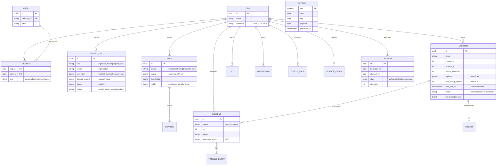
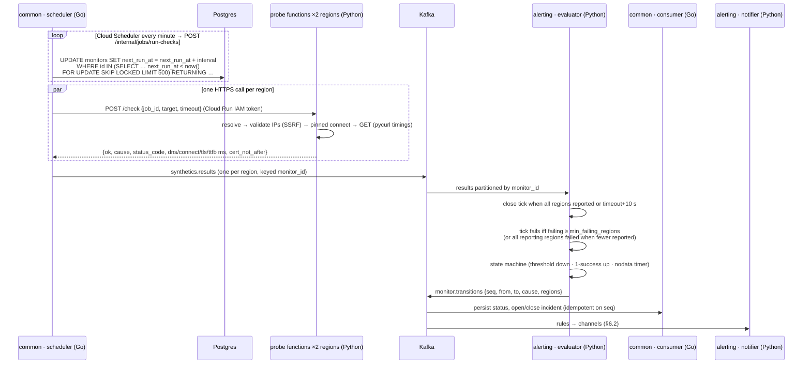
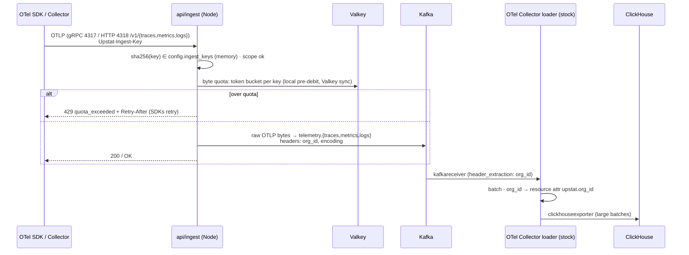

# Upstat — System Design

> **Status: [Proposed] v2.1 — draft for ratification (2026-09-24).** This
> document replaces the system design described across `architecture.md`
> §1–§7, `data-model.md` §3, and `deployment.md` §1 once ratified. It keeps
> every **product** decision in [decisions.md](decisions.md) (Google-only
> auth, ClickHouse, Aiven Postgres/Valkey, Brevo, Vertex AI, Cloud Run,
> merge-to-main deploys, OTel everywhere) and every **behavioural** contract in
> the flow docs (monitor state machine, alert dispatch, analytics math,
> query grammar). What it replaces is the **shape of the system**: service
> boundaries, transports, data ownership, and where each piece of work runs.
> New decisions it needs are listed in §13 as **S-1…S-12**.
>
> **Language rule (CueLABS standard):**
> - **Go does CRUD only.** `api/common` owns and persists data, and
>   `api/query` reads it.
> - **Python does all processing:** every decision, such as up/down,
>   anomalies, and alert routing.
> - **The gateway is thin.** It validates and hands off (Node, as in the
>   standard's gateway pattern).
> - **Probes are serverless functions**, the only use the standard allows
>   for functions.
>
> Services are named by function and connected through Aiven Kafka.
>
> **Amendment, 2026-10-13: the shared message bus (decisions.md X-11).**
> Upstat's Kafka is the one service shared with Expendit and Apparule,
> under the CueLABS delivery standard's `references/shared-messaging.md`.
> That service has three shared lanes, two partitions each, about
> 250 KiB/s for all products, no compaction, and fixed retention, so
> several parts of this draft change. Where it says otherwise, the
> amendment wins; the affected sections need rework before ratification:
> - **Telemetry leaves the bus (D3, D5, §5.3, §6.3, §6.4, S-6):** the
>   ingest gateway forwards OTLP to the OpenTelemetry Collector (stock),
>   which exports to ClickHouse; product events and usage bytes reach
>   ClickHouse the same way (as OTLP logs) rather than via
>   `telemetry.events` / `usage.bytes`. The Collector's persistent sending
>   queue replaces "Kafka buffers 24 h" as the ClickHouse outage budget
>   (§9.2). The ClickHouse Kafka table engine is no longer used.
> - **Check results:** `common` still relays probe results to alerting on
>   the bus (`upstat.synthetics.result`); their copy for ClickHouse goes
>   through the Collector.
> - **No compacted config topics (D6, §6.8, S-8):** `common` rewrites a
>   config snapshot object per kind (orgs, members, ingest keys, monitors,
>   rules, channels, registry) and publishes `upstat.config.changed`;
>   consumers reload the snapshot on start and on that event.
> - **Two partitions, not 12 (§9.4, §10.1):** the evaluator can't shard
>   monitors across 12 partitions or rely on co-partitioning
>   `config.monitors` with results (§6.1 `nodata`); it keys
>   `synthetics.result` by monitor id within two partitions and holds the
>   monitor config from the snapshot.
> - **Pointers only:** every payload goes by `data_ref` into Upstat's
>   storage prefix; other products can read the lanes.
> - **One Kafka user, `upstat`;** consumer groups `upstat-<service>`.
> - **Keep-alive:** Expendit owns it; Upstat runs no heartbeat or watchdog.
> - **Request ids:** every request carries a `request_id`, kept when it is
>   re-sent; the owner keeps the first result per `request_id` and drops
>   later ones.
> - **Never block a partition:** a message that keeps failing becomes a
>   failed result on `cuelabs.results` (or is recorded as failed by
>   `common`), and is then committed.
> - **Environments:** only the deployed services (Doppler `stg`) connect to
>   the shared service; local runs use the compose broker, so a laptop
>   never joins a shared consumer group.

## Contents

1. Why redesign — audit findings
2. Design drivers
3. Architecture overview
4. Services
5. Data architecture
6. Key flows
7. API surface
8. Security and tenancy
9. Reliability, failure modes, and capacity
10. Deployment topology
11. Repository layout
12. Reuse map — keep, change, retire
13. Decisions to ratify
14. Migration plan
15. Open questions

---

## 1. Why redesign — audit findings **[Current]**

The code on `main` is small: roughly 2.3k lines of Go (`api/common`), 1.6k
lines of Python (`api/observability`), and 38k lines of TypeScript in `web`,
which today runs entirely on its in-app mock server. The product target
(prd.md §9) is a full observability platform. The current shape cannot
grow into that target without being rebuilt, for these reasons:

| # | Finding | Evidence | Consequence |
| --- | --- | --- | --- |
| F1 | **One Go process does four jobs**, three of which are decisions. `api/common` is the API, the check scheduler, the prober, and the state-machine evaluator. | `cmd/server/main.go` starts `MonitorWorker` in-process; `monitor_worker_service.go` polls, probes, and decides. | This breaks the standard, which says Go only does CRUD. The API also can't scale without duplicating checks. |
| F2 | **Checks run in lock-step batches.** Each 5 s tick lists *every* active monitor, then `wg.Wait()`s for the whole batch at concurrency 10. | `runOnce()`; `ExecuteHttpCheck` retries 3× with 500 ms sleeps and a 10 s default timeout. | Ten slow targets (≈31 s each) stall every other monitor for ~31 s. Check timing drifts under load. |
| F3 | **Single-vantage probing.** All checks come from one region, the same one that hosts the API. | One worker, one Cloud Run region today; the target probes from two. | Our own network blips page customers as "down", and a regional outage silences all alerting. The in-check 3× retry hides flapping and inflates response times. |
| F4 | **The SSRF hard rule isn't implemented.** | No private/link-local/metadata IP validation anywhere in `api/` (flows/monitor.md §1 requires it). | On Cloud Run, a monitor targeting `169.254.169.254` reaches the metadata server. |
| F5 | **Cyclic, synchronous service coupling.** `common` and `observability` call each other over gRPC, and Python opens its own Mongo connection. | `monitor_service.go:25-41`; `api/observability/database/mongo.py`. | Breaks the standard's pipeline rule (the processor never touches common's store), and is exposed to the Cloud Run zombie-channel problem. |
| F6 | **Telemetry in the control-plane store.** Check results sit in Mongo, and Phase 1 plans to put events in Postgres and later move them to ClickHouse. | data-model.md §3, features.md U1-0. | Everything gets built twice, and the control-plane database carries the highest-write workload. |
| F7 | **Ingestion is planned as a custom gateway that also writes storage.** | api.md §1a. | Mixes a thin gateway with persistence, and reinvents loaders that already exist (the OTel Collector, ClickHouse's Kafka engine). |
| F8 | **gRPC-Web is kept for a client nobody uses.** | README: "retained but not yet wired"; the web reads `/api/mock/v1`. | Extra proxy config and generated clients support a path with zero traffic. |
| F9 | **The docs contradict themselves.** architecture.md §6.6 excludes APM/tracing/logs, while prd.md §9 makes them core. | — | Contributors can't tell which design is current. |

What *is* solid and carries forward: the behavioural contracts (flows/*,
analytics-math, query grammar, engineering error catalog and authz
matrix), the web app and its mock API (already a complete HTTP contract,
§7.3), the check/incident semantics in the worker (they move to Python),
the Python analysis and ML modules, and the delivery scaffolding.

---

## 2. Design drivers

| # | Driver | Design response |
| --- | --- | --- |
| D1 | **The monitor must not share fate with what it monitors, or with itself.** | Probes are serverless functions in two regions. Alert decisions never depend on the UI. Status pages are CDN-cached. An external dead-man's switch watches Upstat (§9.3). |
| D2 | **Language by role** (the standard's pipeline rule). | Go = CRUD (`common` writes, `query` reads). Python = processing (`alerting`, `observability`). Node = thin gateway (`ingest`). Functions = probes. |
| D3 | **Two planes, one owner each.** | **Control plane:** Postgres, written only by `api/common`. **Telemetry plane:** ClickHouse, written only from Kafka by stock loaders, and read only by `api/query`. Go owns both schemas (migrations live in `api/common`). |
| D4 | **Asynchronous by default between services.** | Kafka carries every handoff. The only synchronous internal calls are `common → probe functions` (a check needs its answer) and `Python → api/query` (reads). No gRPC between services. |
| D5 | **No custom code where a stock component exists.** | Kafka→ClickHouse loading uses the stock OpenTelemetry Collector (OTLP topics) and ClickHouse's Kafka table engine (JSON topics). Rollups are ClickHouse materialized views. |
| D6 | **Config flows outward as events.** | `api/common` publishes config changes through a transactional outbox to compacted Kafka topics. The gateway and the Python services keep an in-memory copy and never query Postgres. |
| D7 | **Privacy by construction.** | Raw IPs never leave the gateway's memory. The event schema is the privacy boundary. Row-level tenancy is enforced in both stores. |
| D8 | **One set of images for cloud and self-host.** | Every managed dependency has a single-container self-host equivalent. The probe function also runs as a container for self-host. |

---

## 3. Architecture overview

```mermaid
flowchart LR
    subgraph Clients
        BR[Browser]
        JS[upstat.js<br/>customer sites]
        OT[OTel SDKs / Collectors]
    end

    subgraph Edge
        WEB[web — Next.js<br/>App Hosting + CDN]
    end

    subgraph Go — CRUD
        COMMON[api/common — Go<br/>auth · orgs · CRUD · scheduler · outbox]
        QRY[api/query — Go<br/>reads ClickHouse]
    end

    GW[api/ingest — Node<br/>thin gateway]
    PRB[probe · Cloud Run functions<br/>Python · 2 regions, planned]

    subgraph Python — processing
        ALR[api/alerting — Python<br/>quorum · state machine · notify]
        OBS[api/observability — Python<br/>anomaly · insights]
    end

    LD[Loaders — stock, no custom code<br/>OTel Collector · ClickHouse Kafka engine]
    PG[(Postgres)]
    CH[(ClickHouse)]
    R[(Valkey)]
    K[[Aiven Kafka]]

    BR --> WEB
    WEB -->|proxies /api/v1/*| COMMON
    WEB -->|proxies /api/v1/query, stats …| QRY
    JS -->|/v1/events| GW
    OT -->|OTLP| GW

    COMMON --> PG
    COMMON <-->|HTTPS call → result| PRB
    COMMON -->|config · check results| K
    K -->|decisions| COMMON
    GW -->|telemetry · events| K
    K -->|results · config| ALR -->|transitions · deliveries| K
    K -->|transitions| OBS -->|insights| K
    K --> LD --> CH
    QRY --> CH
    ALR -. read .-> QRY
    OBS -. read .-> QRY
    COMMON -.- R
    GW -.- R
    ALR -.- R
```

---

## 4. Services

Six deployables we write (web, two Go, one Node, two Python), plus one
serverless function and one set of stock loaders. Ports follow the
standard: `api/common` 8080, then each service in the order it was added.
`observability` already holds 8081.

| Unit | Lang | Role | Responsibility | Owns | Port |
| --- | --- | --- | --- | --- | --- |
| `web` | Next.js | Frontend | Landing, dashboard, public status pages (ISR), `/docs/api`, serves `upstat.js` | — | 3000 |
| `api/common` | **Go** | **CRUD (write)** | Control-plane API: Firebase auth, orgs/roles, monitors, rules, channels, incidents, SLOs, dashboards, keys, event registry, catalog, status pages. **Check scheduler** (lookup-then-write) that calls the probe functions and relays their results to Kafka. **Outbox publisher.** Persists every decision Python makes (transitions, incidents, deliveries, insights). Owns the Postgres **and** ClickHouse schemas (migrations). | **Postgres** (sole client) | 8080 |
| `api/observability` | **Python** | Processing | Anomaly detection, insight narratives (Vertex AI; Groq/Gemini BYO key for self-host), log patterns (OBS-012), forecasting | nothing: reads via `api/query`, emits via Kafka | 8081 |
| `api/ingest` | **Node** (NestJS) | Thin gateway | OTLP over HTTP and gRPC, and `/v1/events`: key auth, scope, byte quotas, origin allowlist, event-registry validation, `visitor_hash` → Kafka. **OTLP payloads pass through unparsed.** | nothing | 8082 (+4317/4318 in self-host) |
| `api/query` | **Go** | **CRUD (read)** | Parses the shared grammar, compiles an org-scoped query to SQL, routes by time range (raw/1m/1h), enforces limits, caches in memory. Serves explorers, dashboards, `/v1/stats`, and the Python services' reads. | read-only ClickHouse user | 8083 |
| `api/alerting` | **Python** | Processing | **Evaluator:** multi-region quorum, the monitor state machine (flows/monitor.md §2), nodata timers, metric/log/trace/SLO-burn rules via `api/query`. **Notifier:** rules → channels, cooldown, flapping, retries, webhook signing, Brevo. | working state in Valkey (rebuildable); Planned | 8084 |
| `probe` | **Python** | Serverless function | One HTTP check per call: SSRF-safe dial, DNS/connect/TLS/TTFB timings (pycurl), certificate expiry. Planned: **Cloud Run functions in 2 regions** (us-central1, us-east4); runs as a container for self-host. | nothing; no secrets, no IAM roles | n/a |
| Loaders | stock | Infrastructure | **OpenTelemetry Collector** (contrib image, configuration only): Kafka OTLP topics → ClickHouse. **ClickHouse Kafka table engine:** JSON topics (events, check results) → ClickHouse. | — | — |

**Retired:** the gRPC product services, the in-process
`MonitorWorker`, the `InsightService` gRPC, the Phase-1 rollup worker
(replaced by ClickHouse MVs), and the Go-based checker (it moves to the
Python probe function).

**Why these boundaries.**
- **`query` is separate from `common`** because one expensive log search
  must never queue behind, or starve, the control-plane API.
- **`alerting` is separate from `observability`** because an ML crash or
  a slow Vertex AI call must never delay a "site is down" alert.
- **Probes are functions**, which is the one use the standard allows.
  They're regional by deployment, hold zero privileges, and scale to
  zero between checks.

---

## 5. Data architecture

### 5.1 Stores and ownership

| Store | Holds | Written by | Read by | Source of truth? |
| --- | --- | --- | --- | --- |
| **Aiven Postgres** (`sandbox-db`, database and user `upstat`) | Control plane (§5.2) + outbox | `api/common` | `api/common` | Yes |
| **ClickHouse** (ClickHouse Cloud account, S-4; not in the GCP IaC) | Spans, logs, metrics, check results, events, rollups, usage (§5.3) | **only from Kafka**, by the stock loaders (insert-only user) | `api/query` (read-only user) | Yes, for telemetry |
| **Aiven Kafka** | Handoffs + compacted config (§5.4) | per topic | per topic | No; a durable buffer. Config topics are rebuildable from Postgres. |
| **Aiven Valkey** (`sandbox-cache`, user `upstat`, keys `upstat:*`) | `common`: per-user API rate limits (engineering.md §3). `ingest`: per-key byte quotas, pre-auth IP limits, daily visitor-hash salts. `alerting`: evaluator working state, cooldown stamps, 30-min flapping windows. | those three | same | No. Losing it is survivable (§9.2). |
| **Cloud Storage** `upstat/<env>/…` | Postmortem bodies, exports, ClickHouse backups, ML model artifacts | common, observability, CH backup | same | Yes, for blobs |

`api/query` deliberately does **not** use Valkey. It caches results in
process memory and enforces the per-org concurrency cap per instance.
That drops a dependency from the read path at the cost of cache hits
across instances, which is fine at this scale.

### 5.2 Control plane — Postgres

Every tenant-owned table carries `org_id`. Row-level security is on, with
the policy `org_id = current_setting('upstat.org_id')`. `api/common` sets
this per transaction, and the repository layer filters on `org_id` too.



Tables in data-model.md §2/§5 keep their fields. The table above shows
only what the redesign adds or changes: `firebase_uid` replaces
`password_hash`; monitors gain `regions`, `min_failing_regions`,
`next_run_at`, and `last_transition_seq`; `PROPERTY` folds into
`INGEST_KEY` (`kind = property_key`), matching the web's `ApiKey` model;
`DISPATCH` becomes `DELIVERY`; and one `INCIDENT` table covers both
auto-opened monitor incidents and declared SRE incidents. **No telemetry
in Postgres.**

### 5.3 Telemetry plane — ClickHouse

Schemas are Go-owned migrations in `api/common/migrations/clickhouse`.

- **OTel tables** use the `clickhouseexporter` canonical schema (the one
  ClickStack/HyperDX query), created with `create_schema: false`. The
  migration adds
  `org_id LowCardinality(String) MATERIALIZED ResourceAttributes['upstat.org_id']`
  and leads every `ORDER BY` with `org_id`. The loader copies the Kafka
  header `org_id` (set by the gateway) into that resource attribute
  (§6.3).
- **Upstat-native tables:**

| Table | Engine / key | TTL (U-6) | Fed by |
| --- | --- | --- | --- |
| `otel_traces` | MergeTree, `(org_id, ServiceName, SpanName, toDateTime(Timestamp))` | 7 d | OTel Collector loader |
| `otel_logs` | MergeTree, `(org_id, ServiceName, TimestampTime)` + token bloom index on `Body` | 15 d | OTel Collector loader |
| `otel_metrics_{gauge,sum,histogram,…}` | exporter schema + `org_id` | raw 15 d | OTel Collector loader |
| `metrics_1m`, `metrics_1h` | AggregatingMergeTree MVs | 90 d / 13 mo | MV on raw metrics |
| `check_results` | MergeTree, `(org_id, monitor_id, scheduled_at, region)`; `ok`, `cause`, `status_code`, `dns_ms`, `connect_ms`, `tls_ms`, `ttfb_ms`, `total_ms`, `cert_not_after` | 90 d | Kafka engine ← `synthetics.results` |
| `check_uptime_daily` | AggregatingMergeTree MV | 13 mo | MV (status-page bars, 90 d strips) |
| `events` | MergeTree, `(org_id, property_id, name, ts)`; typed dim columns (closed vocabulary) | 90 d | Kafka engine ← `telemetry.events` |
| `events_hourly`, `events_daily` | AggregatingMergeTree, `uniqState(visitor_hash)` | 90 d / 13 mo | MV |
| `visits_hourly` | Refreshable MV (hourly), 30-min-gap sessionization (analytics-math §2) | 90 d | refreshable MV |
| `usage_hourly` | SummingMergeTree | 13 mo | Kafka engine ← `usage.bytes` |

Late events land in the right bucket automatically, because aggregating
MVs merge late inserts. That settles analytics-math §7's rollup-worker
concerns by construction.

**Row policy (defense in depth):** the `query_ro` user has
`CREATE ROW POLICY … USING org_id = getSetting('SQL_upstat_org')`, and
`api/query` sets that setting on every query in addition to injecting the
predicate.

### 5.4 Kafka events (on the shared bus)

Upstat uses the CueLABS shared message bus (decisions.md X-11; the
standard's `shared-messaging.md` is the source of lanes, envelope, limits
and operations). Only control-plane hand-offs ride it; telemetry goes
through the OpenTelemetry Collector (amendment at the top). This table
lists only Upstat's events; JSON Schemas live in `api/common/contract/`,
and every payload travels by pointer.

| Event | Lane | Key | Producer → consumers |
| --- | --- | --- | --- |
| `upstat.config.changed` | `cuelabs.requests` | config kind | common (outbox) → ingest, query, alerting, observability (reload the snapshot) |
| `upstat.synthetics.result` | `cuelabs.requests` | monitor id | common (relaying probe responses) → alerting |
| `upstat.monitor.transition` | `cuelabs.results` | monitor id | alerting → common, alerting (notifier), observability |
| `upstat.alerting.delivery` | `cuelabs.results` | channel id | alerting → common |
| `upstat.insights.generated` | `cuelabs.results` | monitor id | observability → common |

**Rework needed before ratification:** §5.3's `Kafka engine ←` loaders,
§6.1's co-partitioning, §6.3–§6.4's Kafka hops, §9.2's "Kafka buffers
24 h", §9.4's 12-partition scaling, §10.1's Collector autoscaling on lag,
and S-2, S-6, S-8 follow the amendment at the top.

---

## 6. Key flows

### 6.1 Uptime check, end to end



- **Go stays CRUD.** The scheduler is a lookup-then-write (select due
  monitors, advance `next_run_at`) plus a relay (call the function,
  publish what it returned). Deciding up/down, the quorum and the state
  machine all live in Python, in `api/alerting`.
- **No singleton, no loop.** `FOR UPDATE SKIP LOCKED` lets any number of
  `common` instances schedule without double-dispatch. `common` scales to
  zero, so no background loop runs between requests: Cloud Scheduler job
  `upstat-run-checks` calls `POST /internal/jobs/run-checks` every minute
  (Google OIDC token, verified against `SCHEDULER_AUDIENCE` and
  `SCHEDULER_INVOKER_EMAIL`), and each call runs one pass of due checks.
  The shortest check interval is therefore 60 s.
- **Why common calls the functions directly, not through Kafka.** Cloud
  Run functions are triggered by HTTP, not by Kafka. The call also returns
  the result in its response, so the function needs **no Kafka
  credentials and no secrets at all**. That matters for code that fetches
  arbitrary customer URLs (§8).
- **Jitter.** `next_run_at` is seeded as `created_at + hash(id) mod
  interval`, which keeps flows/monitor.md §3's anti-thundering-herd rule.
- **Timeouts.** `common` waits at most `timeout + 5 s` per call. A missing
  region is treated as "no result", never as a failure. Stale slots are
  skipped (next slot wins).
- **No in-check retries.** Multi-region quorum plus the failure threshold
  does the damping, and response times are single-attempt measurements.
- **`nodata`.** The Python evaluator that owns a monitor's partition runs
  its 2×interval timer. `config.monitors` and `synthetics.results` are
  co-partitioned, so config, results, and timer land on the same consumer.
  If every region fails to report, the monitor goes `nodata`, never
  `down`.
- **Extras from the same check.** Phase timings feed the check-detail waterfall, and
  `cert_not_after` gives OBS-011 certificate-expiry warnings without a new
  check type.

### 6.2 Alert dispatch (MON-001, flows/alert.md unchanged in behaviour)

- The notifier (Python, in `api/alerting`) consumes `monitor.transitions`,
  **partitioned by `monitor_id`**. A monitor's `down` and `recovered` are
  therefore handled in order by one consumer, which satisfies
  flows/alert.md §3's ordering rule without coordination.
- For each matching rule and channel, it delivers with a 10 s timeout and a
  1 s / 5 s / 25 s retry ladder. The Kafka offset is committed only after
  every delivery for that transition is terminal: at-least-once delivery
  that survives a crash.
- Duplicates after a crash carry the same `X-Upstat-Delivery-Id`, and the
  documented webhook recipe tells consumers to dedupe on it.
- Cooldown stamps and the flapping window live in Valkey. If Valkey is lost,
  the notifier fails open: it sends, and never silently suppresses.
- Outcomes go to `alerting.deliveries`, which `common` persists as the
  alert feed (MI-14) and uses to drive channel `degraded` badges.

### 6.3 OTLP ingestion (OBS-001; the ecosystem gateway role)



- **The gateway never parses OTLP.** It authenticates, meters the bytes,
  and forwards the payload unchanged with the org in a Kafka header. That
  keeps a Node gateway fast, and HTTP and gRPC share one path. On gRPC it
  uses a pass-through serializer, so messages stay as raw bytes.
- **Quotas are in bytes per second** per key, the unit most ingest
  products bill on. Counting spans or log lines would require parsing. The
  defaults in engineering.md §3 are converted to byte equivalents (S-11).
- **The loader is configuration, not code.** The stock contrib collector
  runs `kafkareceiver` (with `header_extraction`) → `batch` →
  `clickhouseexporter`. Upgrading the loader is an image bump.
- **Why Kafka and not a direct write.** The accept path keeps meeting its
  p99 < 250 ms SLO while ClickHouse is slow or down. Loaders scale on
  consumer lag. Traces keyed by `trace_id` make tail sampling (U-6
  "later") a loader-side processor.
- **Cloud Run shape.** One port per service, so the gateway deploys twice
  from one image: `ingest-grpc` (end-to-end HTTP/2) at
  `otlp.ingest.upstat.cuesoft.io`, and `ingest-http` at
  `ingest.upstat.cuesoft.io`. Self-host runs one container with both ports.
- **StatsD** needs UDP, which Cloud Run can't serve. Customers run the
  stock collector's `statsd` receiver locally and export OTLP to us.

### 6.4 Product events and RUM (D2, ANA-001, OBS-007)

`api/ingest` serves `POST /v1/events` with the contract in api.md §3
unchanged: batch ≤ 100, per-item rejections, `202 {accepted, rejected,
rejections}`. For each request it:

1. authenticates the property key and matches `Origin` against its
   allowlist;
2. validates each event against `config.registry` (registry-as-schema,
   api.md §3.4a);
3. computes `visitor_hash` (analytics-math §1) with the daily salt from
   Valkey (`SETNX salt:<utc-day>`, 72 h TTL, so it self-destructs after the
   48 h window). The IP and user agent are dropped here and **never reach
   Kafka**;
4. publishes JSON to `telemetry.events`. ClickHouse's Kafka engine loads
   it, and the MVs produce rollups and visits.

Checking a key, a schema, and a hash is validation, not a decision, so it
belongs in the gateway by the standard's definition.

### 6.5 Query path

- `web` proxies `/api/v1/*` server-side. It routes
  `/v1/query`, `/v1/stats`, `/v1/logs*`, `/v1/traces*`, `/v1/metrics*`, and
  `/v1/rum*` to `api/query` (Go), and everything else to `api/common`, each
  at its own run.app URL.
- `api/query` verifies the Firebase token with the shared Go auth package
  and resolves membership and role from `config.members`, held in memory.
- It parses the grammar into the **same `QueryAst v1` the web already
  defines** (`web/src/models/query.ts`) and compiles it with a structured
  SQL builder: org predicate always injected, time range always
  parameterized.
- **Tier routing:** up to 6 h reads raw data; up to 7 d reads `*_1m`;
  anything longer reads `*_1h`.
- **Guards:** `max_execution_time`, `max_memory_usage`, and
  `max_result_rows` per query; a per-org cap of 4 concurrent queries per
  instance; `429` when exceeded.
- **Cache:** in-process, for step-aligned ranges older than one step. Live
  tail bypasses it.
- **Errors:** unknown facets return `422 invalid_query {position, hint}`,
  never an empty result.
- **Python callers** (`alerting` for rule evaluation, `observability` for
  history) use the same HTTP API with a Cloud Run IAM identity token and a
  service role that grants reads only.

### 6.6 Insights (ML)

`api/observability` (Python) consumes `monitor.transitions`, plus a
scheduled sweep for proactive risk scoring. It pulls history through
`api/query`, runs the existing feature builder, risk scorer, and sklearn
detector, renders the narrative with Vertex AI, and emits
`insights.generated`. `common` persists the insight. This removes both
gRPC edges and the Python service's Mongo connection; the analysis
modules move over unchanged.

### 6.7 Public status pages

The web renders `/status/[slug]` with ISR (revalidate 30 s). `common`'s
public `GET /v1/status/{slug}` serves live states from Postgres, plus 90 d
bars from `api/query` behind a 5-minute stale-while-revalidate cache held
in `common`. If `api/query` or ClickHouse is down, the page serves the last
good bars, and the CDN absorbs traffic spikes during incidents.

### 6.8 Config propagation (outbox)

A `common` write and its outbox row commit in one transaction. The
publisher (every instance, `SKIP LOCKED` batches) sends the rows to the
compacted `config.*` topics and stamps `published_at`. Consumers rebuild
their in-memory maps from offset 0 on start. A new ingest key works at the
gateway within about 1 s of creation, and revocation propagates the same
way.

---

## 7. API surface

### 7.1 Hosts

| Host | Routes to | Protocol |
| --- | --- | --- |
| `upstat.cuesoft.io` | web | HTTPS |
| `api.upstat.cuesoft.io` | common (default), query (read paths, §6.5) | HTTP/JSON |
| `ingest.upstat.cuesoft.io` | ingest-http: OTLP/HTTP `/v1/traces\|metrics\|logs`, `/v1/events` | HTTP/JSON + OTLP/HTTP |
| `otlp.ingest.upstat.cuesoft.io` | ingest-grpc | OTLP/gRPC |

OTLP paths are the standard ones, so a customer sets only
`OTEL_EXPORTER_OTLP_ENDPOINT=https://ingest.upstat.cuesoft.io` and
`OTEL_EXPORTER_OTLP_HEADERS=Upstat-Ingest-Key=…`.

The probe functions are **not public**. They accept only calls carrying a
Cloud Run IAM identity token for `api/common`'s service account.

### 7.2 Protocol stance

HTTP/JSON everywhere a person or a product calls Upstat. **gRPC only at
OTLP ingest.** No browser gRPC-Web and no gRPC between services
(S-7).

### 7.3 The web mock server *is* the contract

`web/src/app/api/mock/v1/**` (≈30 route groups) plus `web/src/models/*.ts`
already specify, and test, the whole HTTP API the dashboard needs. The
backend implements that contract; it does not redesign it:

1. Generate the full `docs/api/openapi.yaml` from those routes and models
   (today it covers 9 paths). It becomes the source for Scalar (`/docs/api`)
   and for request validation in `common` and `query`.
2. **Contract tests:** run the web's Vitest controller and model suites
   with `NEXT_PUBLIC_API_BASE` pointed at a compose stack, next to the
   mock. Divergence fails CI.
3. Cut the web over surface by surface: when a surface's real endpoints
   pass the contract suite, its `apiBase` flips. TEST_MODE and the mock
   server stay, as the web standard requires.

Error envelope, pagination, idempotency keys, and CORS follow
engineering.md unchanged.

---

## 8. Security and tenancy

| Concern | Control |
| --- | --- |
| **User auth** | Firebase ID tokens, Google provider only (`provider_not_allowed` otherwise), verified by one shared Go package in `common` and `query`. Legacy JWT/password paths are deleted with the gRPC services. |
| **Authz** | engineering.md §2 role matrix, enforced in `common`. `query` enforces read roles from `config.members`. |
| **Tenancy** | `org_id` everywhere; Postgres RLS; ClickHouse `org_id`-first keys + row policy + builder-injected predicate. The gateway sets `org_id` from the key, never from the payload. Cross-org access returns `not_found`. |
| **Machine identity** | Ingest keys: sha256 at rest, shown once, 24 h rotation grace, scoped, write-only. Between services: Kafka ACLs (a SASL user per service with topic-level grants) and Cloud Run IAM for the synchronous calls (`common → probe`, `Python → query`). The `SERVICE_TOKEN` scheme retires. |
| **SSRF (probes)** | Resolve → reject private, loopback, link-local, CGNAT, metadata, and IPv6 ULA ranges → connect to the validated IP only (pycurl `RESOLVE` pinning, re-checked on every redirect hop). The functions have **no VPC connector, a dedicated service account with zero IAM roles, and no secrets in their environment**. Even a bypass reaches no internal network, and a metadata token grants nothing. Self-host: deny-list configurable. |
| **Privacy** | IP and user agent are consumed and dropped inside the gateway; daily salts expire on their own; the never-log list (engineering.md §5) is CI-grep-gated; the storage-scan test runs against ClickHouse `events`. |
| **Secrets** | Doppler `upstat/stg`, delivered to Cloud Run env. Per-service, least-privilege credentials for Kafka, ClickHouse, and Postgres. |
| **Abuse** | Pre-auth per-IP limits at the gateway, per-key byte quotas, per-user API limits in `common`, and a per-org monitor cap so the probe fleet can't be turned into a DDoS tool. |

---

## 9. Reliability, failure modes, and capacity

### 9.1 Upstat's own SLOs **[Proposed]**

| SLI | Target |
| --- | --- |
| Ingest accept availability (non-429) | 99.9 % / 30 d |
| Ingest accept latency | p99 < 250 ms |
| Check scheduling lag (`called − scheduled_at`) | p99 < 5 s |
| Transition → first notification attempt | p95 < 30 s |
| Query latency, 24 h range | p95 < 2 s |
| Status page availability | 99.95 % (CDN-served) |

### 9.2 Failure modes

| Failure | What keeps working | What degrades | Recovery |
| --- | --- | --- | --- |
| ClickHouse down | Ingest accepts (Kafka buffers 24 h); uptime checks, evaluation, alerts | Explorers, dashboards, metric/log rules (evaluator emits a `rule.eval_error` meta-alert), fresh status bars | Loaders drain the backlog |
| Kafka down (Aiven 3-node HA) | UI reads and writes (outbox accumulates) | Ingest returns 503 (SDKs retry); check results can't be relayed, so monitors go `nodata`, not `down` | Outbox and relays resume |
| Postgres down | Ingest, query, alerting (config cached in memory) | UI writes; scheduling stops, so monitors go `nodata` | Resume |
| One probe region down | The other region's result decides (fewer reported) | Region shown as missing on check detail | n/a |
| A slow target | Everything else: each check is its own function call with its own timeout | — | — |
| Valkey down | Ingest (local quota pre-debit), `common` (rate limits fail open), alerting (fail-open notifications) | Exact quotas and cooldowns, and uniques salts for the rest of the day | Rebuild |
| `api/alerting` down | Checks run and results queue in Kafka | Alerts delayed until it restarts; nothing lost | Consumer resumes from offset |
| `api/common` deploy | Cloud Scheduler retries on the next minute | Brief UI write blip; at most one pass skipped | n/a |
| Cloud Scheduler job paused or failing | UI, ingest, query | Scheduling stops, so monitors go `nodata`; the dead-man's switch (§9.3) alerts | Resume the job |

### 9.3 Who watches Upstat

Two independent watchers:

1. Upstat monitors its own endpoints through its own pipeline, which is
   what the public status page shows.
2. A **dead-man's switch outside the stack**: a GCP Cloud Monitoring
   uptime check on the `api` and `ingest` health endpoints, plus a
   heartbeat the evaluator emits every minute. Either one alerts the
   owners through Cloud Monitoring's own notification channels.

### 9.4 Capacity sketch

- **Checks:** 10k monitors at a 60 s interval across 2 regions ≈ 333
  function calls/s. `common` holds them as lightweight outstanding HTTP
  calls: a few hundred in flight at a p50 of 300 ms, and about 5k in the
  worst case (everything timing out at 10 s). That's cheap in Go and
  spread across instances. Each function instance handles many
  concurrent checks (pycurl multi), so instance counts stay low.
- **Evaluator:** 333 results/s is comfortable for a Python consumer.
  Throughput scales by adding consumers up to the partition count (12).
- **Ingest:** the Node gateway does no parsing, only a hash, a Valkey
  debit, and a Kafka produce per request, so it scales by adding
  instances.
- **ClickHouse** stays single-node until load demands otherwise. The
  upgrade path is ReplicatedMergeTree plus Keeper (architecture.md §6.2).

---

## 10. Deployment topology

### 10.1 Cloud (X-3, X-6: deploys on merge to main, `stg` only)

| Unit | Cloud Run kind | Region(s) | Scaling | State |
| --- | --- | --- | --- | --- |
| web | Firebase App Hosting | n/a | managed | Built |
| api/common (Go) | Service, HTTP/2 (h2c) | us-central1 | 0-5 | Built, `upstat-api-common` |
| api/observability (Python) | Service, HTTP only | us-central1 | 0-3 | Built, `upstat-api-observability` |
| api/query (Go) | Service | us-central1 | 0-5 | Planned |
| api/ingest (Node) ×2: http, grpc | Service | us-central1 | 0-10 | Planned |
| api/alerting (Python) | Service | us-central1 | 0-3 | Planned |
| probe (Python) | Cloud Run functions | us-central1, us-east4 | 0-N per region, concurrency > 1 | Planned, 2 regions |
| Loader: OTel Collector (stock image) | Service | us-central1 | 0-5 | Planned |
| Loader: ClickHouse Kafka engine | inside ClickHouse | n/a | n/a | Planned |
| Postgres (`sandbox-db`), Valkey (`sandbox-cache`), Kafka | Aiven | us-central1 | n/a | Postgres and Valkey in use |
| ClickHouse | ClickHouse Cloud account, outside the GCP IaC | n/a | n/a | Planned |
| Firestore (Mongo-compatible) | GCP sandbox | us-central1 | n/a | In use |

Every service is a Cloud Run service with min instances 0. Work that needs a clock is driven by Cloud
Scheduler (`upstat-run-checks`, §6.1); consumers of Kafka run as services
that Cloud Run scales from zero on request. The web proxies `/api/v1/*` to
the common service. Staging is GCP project
`sandbox-e306a`, run.app URLs
`https://<service>-805800737799.us-central1.run.app`. Provisioning goes through the IaC stack, which is also where Cloud
Run functions are provisioned today.

### 10.2 Self-host (compose + Helm)

Compose runs `postgres`, `clickhouse`, `kafka` (Apache Kafka, KRaft,
single node), `redis`, `otel-collector` (stock contrib image), the five
app services, and the probe as a container (`functions-framework`,
`PROBE_REGION=local`, quorum 1). A `make up-lite` profile skips
`observability`. Helm uses the same images; stateful dependencies are
external endpoints or opt-in subcharts. 

### 10.3 Environment variables (fleet names only)

`DATABASE_URL` · `REDIS_HOST/PORT/USERNAME/PASSWORD/TLS/DB` ·
`KAFKA_BROKERS/USERNAME/PASSWORD/SSL_CA` · `CLICKHOUSE_URL` (+ per-service
user/password) · `FIREBASE_PROJECT_ID` · `BREVO_API_KEY/FROM_EMAIL/FROM_NAME` ·
`OTEL_*` · `CORS_ORIGINS` · `PROBE_URLS` (common: one per region) ·
`GOOGLE_CLOUD_PROJECT`/Vertex region.

Retired: `MONGO_URI`, `MONGO_DB`, `JWT_SECRET`,
`INSIGHT_GRPC_ADDR`, `UPSTAT_GRPC_*`, `NEXT_PUBLIC_ENVOY_URL`.
New on `common`: `SCHEDULER_AUDIENCE`, `SCHEDULER_INVOKER_EMAIL` (the run-checks guard) and `WORKER_ENABLED` (false on Cloud Run).
`CLICKHOUSE_URL` and `PROBE_URLS` are new names and need adding to the
delivery standard's fleet list (S-10).

---

## 11. Repository layout (target)

```
api/
  common/          Go — CRUD owner (module github.com/cuesoftinc/upstat/api/common)
    cmd/server/
    internal/{config,handler,middleware,model,repository,service,router,scheduler,outbox,consumer}
    migrations/{postgres,clickhouse}/   Go owns both schemas
    pkg/{auth,kafkax,configbus,httpx}   shared with api/query via replace ../common
    contract/      JSON Schemas for every Kafka message (Go, Python, Node validate against them)
  query/           Go — grammar parser, AST, SQL builder, tier router (read-only)
  ingest/          Node (NestJS) — src/{health,otlp,events,auth,quota}
  alerting/        Python (FastAPI shell + consumers) — evaluator/, notifier/, channel/{webhook,brevo}
  observability/   Python — insights/ML (existing layout; repository/ rewritten)
functions/
  probe/           Python — Cloud Run function (functions-framework) + Dockerfile for self-host
deploy/{docker,helm,terraform}
  docker/otel-collector.yaml   loader config (stock image)
web/               unchanged layout; src/proto/ + grpc-web deps removed
docs/
```

`functions/` is a new top-level directory. The standard has no home yet
for function source that must also ship open-source for self-host
(the IaC stack holds only provisioning). S-12 ratifies it.

---

## 12. Reuse map — keep, change, retire

| Existing code | Fate |
| --- | --- |
| `api/common/cmd/server/main.go` (slog, h2c mux, graceful shutdown) | **Keep** skeleton; drop gRPC registration; mount HTTP router |
| `internal/service/monitor_worker_service.go` | **Port to Python** in `api/alerting/evaluator` (threshold and incident logic, plus nodata, quorum, flapping); the Go file retires |
| `internal/service/checker_service.go` | **Port to Python** in `functions/probe` (pycurl): drop in-loop retries, add SSRF pinning and phase timings |
| `internal/service/monitor_service.go`, `user_service.go` (gRPC) | **Rewrite** as HTTP handlers against Postgres; validation rules carry over |
| `internal/repository/*` (Mongo) | **Replace** with Postgres repositories; check/insight repos go away (ClickHouse / Kafka) |
| `internal/util/{jwt,auth,google_auth}.go` | **Retire** for `pkg/auth` (Firebase) |
| `internal/proto/*` | **Retire** (gRPC) |
| `api/observability/{analysis,ml,service}` | **Keep** as-is |
| `api/observability/{repository,database,router/grpc_server.py}` | **Rewrite**: `api/query` client + Kafka consumer/producer; gRPC server removed |
| `service/groq_renderer.py` | **Keep** as the self-host fallback; add Vertex renderer (U-8/X-4) |
| `web/**` | **Keep** everything; remove `src/proto`, `grpc-web`, `google-protobuf`; flip `apiBase` per surface |
| `web/src/app/api/mock/v1/**`, `web/src/models/**` | **Keep**; they become the contract (§7.3) |
| `deploy/helm/envoy`, compose `envoy` | **Retire** (local only; no cloud use) |
| `deploy/helm`, `deploy/terraform`, compose, Makefile, CI | **Extend** with the new services and stores |
| Docs: flows/*, analytics-math, query-grammar, engineering | **Keep**; behaviour unchanged (engineering §3 quota units → bytes, S-11) |
| Docs: architecture.md, data-model.md §1/§3, deployment.md §1/§4, api.md §1/§1a | **Rewrite** from this document on ratification |

---

## 13. Decisions to ratify

| ID | Decision | Supersedes | Recommendation |
| --- | --- | --- | --- |
| **S-1** | Units: web · `api/common` (Go, CRUD) · `api/query` (Go, reads) · `api/ingest` (Node, gateway) · `api/alerting` (Python) · `api/observability` (Python) · probe (Python functions) · stock loaders | architecture.md §1–3, api.md §1a, deployment.md §1 | ⭐ ratify |
| **S-2** | **Aiven Kafka** between services; synchronous only for `common → probe` and `Python → query` | architecture.md §6.2 "no external buffer", X-8 internal s2s gRPC | ⭐ ratify. Fallback if the budget is refused: a Postgres job table + ClickHouse `async_insert`, losing the ClickHouse-outage buffer |
| **S-3** | Check results, events, and rollups live **only in ClickHouse**; Phase 1 writes events there directly | features.md U1-0 / U2-7, data-model.md §3 | ⭐ ratify |
| **S-4** | ClickHouse on **ClickHouse Cloud** (account outside the GCP IaC; Planned) | n/a | ⭐ ClickHouse Cloud |
| **S-5** | **Multi-region probing**, quorum `min_failing_regions = 2` of 2; regions `us-central1`, `us-east4` (Planned) | in-check retries; single worker | ⭐ regions ruled (§15 Q1) |
| **S-6** | Telemetry loading uses **stock components only** (OTel Collector, ClickHouse Kafka engine); the gateway forwards raw OTLP | api.md §1a "ingest gateway writes storage"; `/v1/otlp/*` prefix → standard paths | ⭐ ratify |
| **S-7** | **Retire gRPC product APIs now** | X-8 "sunset at monitors-v2" | ⭐ ratify (web never wired) |
| **S-8** | Config propagation by **transactional outbox → compacted topics** | — | ⭐ ratify |
| **S-9** | Tenancy defense in depth: Postgres RLS + ClickHouse row policies | engineering.md §2 (app-level only) | ⭐ ratify |
| **S-10** | Consumers run as scale-to-zero services; `api/query` shares `api/common/pkg` via `replace`; new env names `CLICKHOUSE_URL`, `PROBE_URLS` | deployment.md §4; self-contained-service default | ⭐ ratify, propose names upstream |
| **S-11** | Ingest quotas in **bytes/s** per key; `api/query` uses no Valkey | engineering.md §3 per-signal point quotas | ⭐ ratify |
| **S-12** | Probe source lives in `functions/probe/` (Python, open-source, container for self-host); the IaC stack provisions it | — (no home for function source) | ⭐ ratify, and add `functions/` to the standard's layout |

On ratification: record S-1…S-12 in decisions.md, update
`.cuelabs/project.yaml` (`backend: {common,
observability, ingest, query, alerting}`, all `planned`; `capabilities.grpc`
limited to ingest), and rewrite the docs listed in §12's last row.

---

## 14. Migration plan

Ordered for cross-repo leverage (siblings are blocked on D2) and
reversibility. Each phase ships behind the web's per-surface `apiBase`
flip, so the mock keeps serving anything not yet real.

| Phase | Delivers | Exit criteria | Maps to |
| --- | --- | --- | --- |
| **A. Foundations** | Provision Postgres, Kafka, ClickHouse, Valkey (cloud + compose); `common` rebuilt on HTTP + Postgres: auth, orgs, members, keys/properties, event registry, outbox, Postgres + ClickHouse migrations; delete Envoy + gRPC | Web auth/org/keys surfaces run against real `common`; contract suite green for them | UX-1…UX-3, U1-0, U1-1 |
| **B. Events (D2)** | `api/ingest` (Node) with `/v1/events` + `visitor_hash`; ClickHouse Kafka engine + events MVs + visits; `api/query` minimal (`/v1/stats`); `upstat.js` | apparule/expendit events visible in `/v1/stats`; storage-scan privacy test green; **D2 declared delivered** | U1-2…U1-8, U2-1 |
| **C. Uptime v2** | `functions/probe` in 2 regions; Cloud Scheduler-driven run-checks + relay in `common`; `api/alerting` (Python evaluator + notifier, webhook + Brevo); retire `MonitorWorker` | Release smoke: down → alert → recover across regions; transition-table tests green; one region killed ≠ down | U2-2…U2-5, UX-7 |
| **D. OTLP + explorers** | OTLP pass-through in `api/ingest`; stock collector loader; traces/logs/metrics tables + rollups; `query` grammar complete; explorers flip off mock; metric/log rules in the evaluator | Siblings export OTLP (X-9) and see their own traces; grammar corpus (30/30) green | U3-*, U4-*, U5-*, UX-8 |
| **E. Intelligence** | `observability` on Kafka + `api/query`; Vertex renderer; log patterns | Insights appear from transitions with no gRPC anywhere | U-8, OBS-012 |
| **F. SRE layer** | Incidents v2, SLOs + burn monitors, catalog, status pages v2 | Per pages.md acceptance | U7-* |

**Data migration.** Mongo holds only local/sandbox data today; no
production exists (X-6). The plan is a one-shot export of any monitors
worth keeping, not a dual-write parity harness (§15 Q2).

---

## 15. Open questions

1. **Probe regions.** Ruled: `us-central1` and `us-east4` (Planned, 2 regions).
2. **Existing data.** Are there any real users or monitors in the current
   Mongo that must survive? If not, the flows/auth.md §3 password-migration
   window and U2-7's parity harness can be dropped.
3. **Gateway language.** Node follows the standard's gateway example. If
   the team prefers fewer languages, the gateway could be Python, at the
   cost of lower per-instance throughput on the hottest path.
4. **Team capacity.** Phases B and C can run in parallel with two people;
   with one, B goes first because the sibling products are blocked on it.
